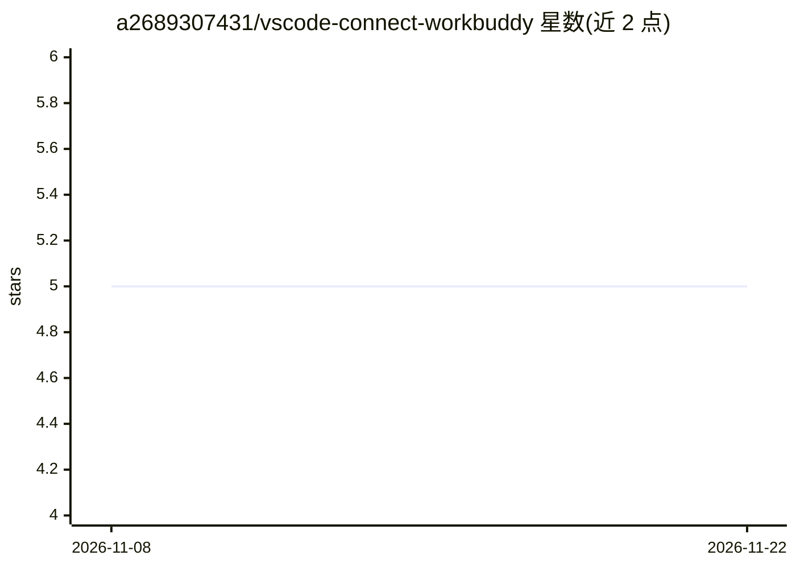

# a2689307431/vscode-connect-workbuddy

⭐ 5 · JavaScript · MIT · 推送 2026-11-11 · [GitHub](https://github.com/a2689307431/vscode-connect-workbuddy) · 个人维护 · 中文 README

**把 WorkBuddy/CodeBuddy 模型接入 VS Code Copilot Chat 的扩展**

非官方 VS Code 扩展，通过 languageModelChatProviders API 与本地代理进程，将 WorkBuddy / CodeBuddy 账号可用的模型写入 Copilot Chat 的模型下拉框，复用 @workspace、Agent 模式、MCP 等既有工作流。提供多账号分组切换、状态栏积分查看、每日签到、上下文 token 用量显示、图片输入与思考过程折叠。凭据经浏览器 OAuth 登录并本地存储，代理只监听 127.0.0.1。作者说明该扩展无法上架官方 Marketplace，经 GitHub Release 分发，不支持代码补全与 inline edit。

## 筛选速览

| 维度 | 判定 | 备注 |
|---|---|---|
| AI 角色 | `ai-ecosystem` | LLM/agent 周边工具 |
| 许可风险 | `permissive` | MIT |
| 部署形态 | `desktop` | 安装包/桌面程序 |
| 模型依赖 | — | README 未给出锁定关系 |
| 硬件要求 | — | 无带数字的原话,不猜 |
| 安装摩擦 | `low` | 无编译、无系统依赖或容器化 |
| 成熟度 | — | 结构信号不足 |

## 能力要点

- 模型出现在 Copilot Chat 下拉框，与自带模型并列切换，复用 @workspace/Agent/MCP
- 多账号登录分组、凭据自动顺延、状态栏积分显示与每日签到
- 本地代理只监听 127.0.0.1，端口随机，凭据存本地 vault 并自动续期
- 上下文占用显示来自服务端返回的真实 token 用量

## 适用场景

- 在 Copilot Chat 里统一使用自己的 WorkBuddy/CodeBuddy 账号模型
- 管理个人与公司多个账号并分别查看积分
- 每天自动给所有账号签到积分

## 场景标签

`编码 Agent` · 领域:编码与开发

## 证据(README 行号)

> L3: 把 **WorkBuddy / CodeBuddy** 的模型，接进 **VS Code Copilot Chat** 的模型下拉框 ——
> L309:         ↓  languageModelChatProviders（VS Code 稳定 API）

## 星数曲线

2026-11-08 5 → 2026-11-22 5（+0）

---
*卡片 v1 · prompt 1.4 · 生成 2026-11-21 · 置信度 high · 依据 README sha `e922dfbe7b75` · [字段定义](../../DATASET.md)*
