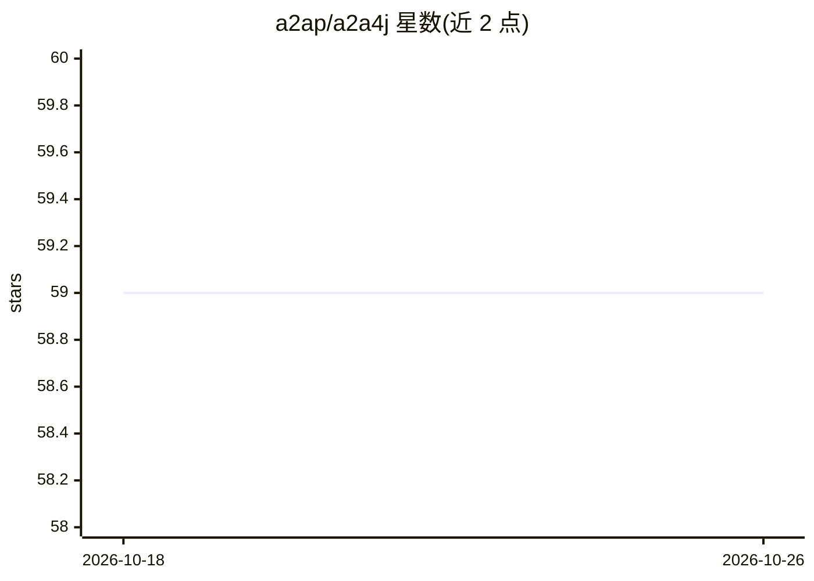

# a2ap/a2a4j

⭐ 59 · Java · Apache-2.0 · 推送 2025-11-24 · [GitHub](https://github.com/a2ap/a2a4j) · 组织维护 · 中文 README

**Agent2Agent 协议的 Java 实现：服务端、客户端与 Spring Boot starter**

面向 Java 开发者的 Agent2Agent（A2A）协议实现库，包含核心模块 a2a4j-core、服务端与客户端 Spring Boot starter 以及示例工程。实现完整 A2A 规范：基于 JSON-RPC 2.0 的请求响应、SSE 流式任务更新、任务生命周期管理、Agent Card 能力发现、push notification 配置等。基于 Reactor 提供响应式编程支持，支持文本/文件/结构化数据交换。要求 Java 17+ 与 Maven 3.6+，通过 Maven Central 以依赖方式引入。

## 筛选速览

| 维度 | 判定 | 备注 |
|---|---|---|
| AI 角色 | `ai-ecosystem` | LLM/agent 周边工具 |
| 许可风险 | `permissive` | Apache-2.0 |
| 部署形态 | `None` |  |
| 模型依赖 | — | README 未给出锁定关系 |
| 硬件要求 | — | 无带数字的原话,不猜 |
| 安装摩擦 | `medium` | 含编译或系统依赖之一 |
| 成熟度 | — | 结构信号不足 |

## 能力要点

- A2A 协议的完整 Java 实现（服务端+客户端+核心模块）
- JSON-RPC 2.0 通信与 SSE 流式任务更新
- 服务端/客户端 Spring Boot starter 自动配置
- Agent Card 能力发现与 webhook push notification 配置

## 适用场景

- 让自研 Java agent 接入 A2A 协议与其他 agent 系统互通
- 基于 Spring Boot 快速搭建 A2A 服务端或客户端
- 学习 A2A 协议的 message/send、tasks 等方法实现

## 场景标签

`Agent 框架` · 领域:Agent 开发

## 证据(README 行号)

> L9: Agent2Agent (A2A) providing an open standard for communication and interoperability between independent AI agent sys
> L11: A2A4J A2A4J is a comprehensive Java implementation of the Agent2Agent (A2A) Protocol, including server, client, exa
> L19: - ✅ **Spring Boot Integration** - Easy integration with Spring Boot applications

## 星数曲线

2026-10-18 59 → 2026-10-26 59（+0）

---
*卡片 v1 · prompt 1.4 · 生成 2026-10-24 · 置信度 high · 依据 README sha `d78825a7573c` · [字段定义](../../DATASET.md)*
