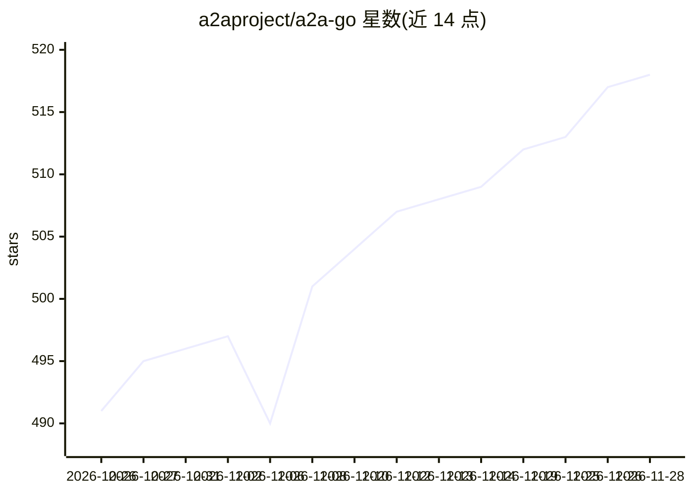

# a2aproject/a2a-go

⭐ 518 · Go · Apache-2.0 · 推送 2026-11-27 · [GitHub](https://github.com/a2aproject/a2a-go) · [官网](https://a2a-protocol.org/) · 组织维护

**供 Go 开发者构建 A2A 协议 Agent 服务的 SDK**

a2aproject 维护的 Go 语言 SDK，用于以 A2A（Agent2Agent）协议运行 agentic 应用。提供客户端（a2aclient）与服务端（a2asrv）两组高层 API，支持 gRPC、REST、JSON-RPC 三种传输绑定，并开放自定义 transport、认证中间件、消息与数据库后端的扩展点。要求 Go 1.26.0 或更新版本，通过 go get 安装，文档位于 pkg.go.dev；配套 CLI 工具 a2a-cli 与示例仓库 a2a-samples 独立分发。采用 Apache 2.0 许可。

## 筛选速览

| 维度 | 判定 | 备注 |
|---|---|---|
| AI 角色 | `ai-ecosystem` | LLM/agent 周边工具 |
| 许可风险 | `permissive` | Apache-2.0 |
| 部署形态 | `library` | 以包/库形式分发 |
| 模型依赖 | — | README 未给出锁定关系 |
| 硬件要求 | — | 无带数字的原话,不猜 |
| 安装摩擦 | `low` | 无编译、无系统依赖或容器化 |
| 成熟度 | — | 结构信号不足 |

## 能力要点

- 客户端与服务端两组 SDK API（a2aclient / a2asrv）
- 支持 gRPC、REST、JSON-RPC 三种协议传输绑定
- 开放 transport、认证、消息与数据库后端扩展点
- 配套独立 CLI 工具 a2a-cli（消息发送、任务查看、AgentCard 解析）

## 适用场景

- 把已有的 agentic 应用按 A2A 协议暴露为服务端
- 用 Go 客户端解析 AgentCard 并向 A2A Agent 发送消息
- 通过自定义 transport 与认证中间件接入既有基础设施

## 场景标签

 · 领域:AI 基础设施/多智能体协议

## 证据(README 行号)

> L10:  A Go library for running agentic applications as A2A Servers, following the Agent2Agent&nbsp;(A2A)&nbsp;Protocol.
> L15: - **Client & Server SDKs:** High-level APIs for both serving agentic functionality (`a2asrv`) and consuming it (`a2

## 星数曲线

2026-10-26 491 → 2026-11-28 518（+27）

---
*卡片 v1 · prompt 1.4 · 生成 2026-11-25 · 置信度 high · 依据 README sha `0f0867098f9b` · [字段定义](../../DATASET.md)*
