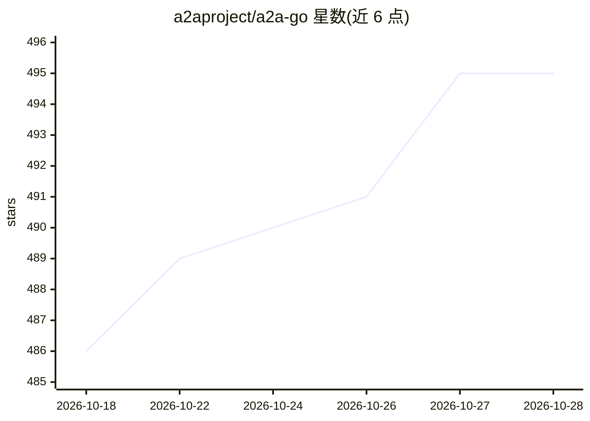

# a2aproject/a2a-go

⭐ 495 · Go · Apache-2.0 · 推送 2026-10-27 · [GitHub](https://github.com/a2aproject/a2a-go) · [官网](https://a2a-protocol.org/) · 组织维护

**A2A 协议的 Go SDK：构建与调用 agent 服务端和客户端**

由 a2aproject 维护的 Go 库，用于将 agentic 应用按 Agent2Agent (A2A) v1.0 协议规范暴露为 A2A 服务端，并提供消费端客户端 SDK。支持 gRPC、REST、JSON-RPC 三种传输绑定，提供传输无关的请求处理器抽象与 AgentCard 解析机制，并开放扩展点：可自带传输实现、认证中间件、消息与数据库后端。需 Go 1.25.0 及以上，配套命令行工具 a2a-cli 位于独立仓库，示例见 a2a-samples 仓库。

## 筛选速览

| 维度 | 判定 | 备注 |
|---|---|---|
| AI 角色 | `ai-ecosystem` | LLM/agent 周边工具 |
| 许可风险 | `permissive` | Apache-2.0 |
| 部署形态 | `library` | 以包/库形式分发 |
| 模型依赖 | — | README 未给出锁定关系 |
| 硬件要求 | — | 无带数字的原话,不猜 |
| 安装摩擦 | `low` | 无编译、无系统依赖或容器化 |
| 成熟度 | — | 结构信号不足 |

## 能力要点

- 遵循 A2A v1.0 协议规范，提供 a2asrv 服务端与 a2aclient 客户端双 SDK
- gRPC/REST/JSON-RPC 多传输绑定
- 可插拔扩展点：自定义传输、认证中间件、消息与数据库后端
- 配套 a2a-cli 命令行工具（独立仓库）用于发消息、查看任务、解析 AgentCard

## 适用场景

- 用 Go 把自己的 agent 封装为符合 A2A 协议的服务端
- 编写客户端调用其他 A2A agent 并交换消息
- 为多 agent 系统实现 A2A 协议的传输层与认证扩展

## 场景标签

`多智能体` · 领域:Agent 开发

## 证据(README 行号)

> L10:  A Go library for running agentic applications as A2A Servers, following the Agent2Agent (A2A) Protocol.
> L15: - **Client & Server SDKs:** High-level APIs for both serving agentic functionality (`a2asrv`) and consuming it (`a2

## 星数曲线

2026-10-18 486 → 2026-10-28 495（+9）

---
*卡片 v1 · prompt 1.4 · 生成 2026-10-21 · 置信度 high · 依据 README sha `cfd728239f13` · [字段定义](../../DATASET.md)*
