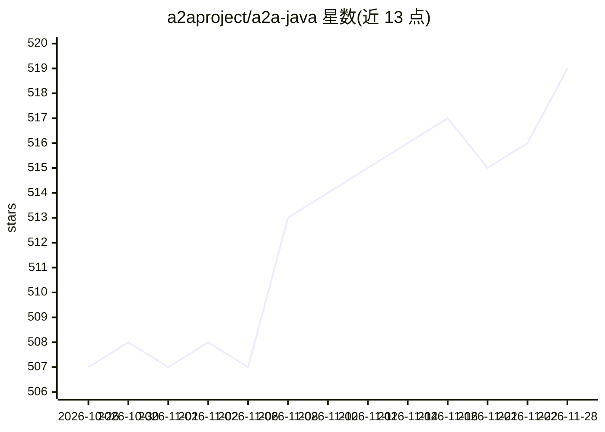

# a2aproject/a2a-java

⭐ 519 · Java · Apache-2.0 · 推送 2026-11-26 · [GitHub](https://github.com/a2aproject/a2a-java) · [官网](https://a2aproject.github.io/a2a-java/) · 组织维护

**Java 开发者将 agentic 应用接入 A2A 协议的官方 SDK**

A2A 协议的官方多模块 Maven 库，提供 client 与 server 支持，使 Java agentic 应用能作为 A2A 服务器运行，并通过 JSON-RPC、gRPC、REST 三种传输方式与其他 A2A 兼容 agent 通信。1.x 版本为活跃支持线，附带兼容模块可与 A2A v0.3 客户端和 agent 通信。需 Java 17+，通过 Maven 依赖引入，另有 OpenTelemetry、JPA 任务存储、Kafka 队列管理器、Vert.x 与 Android HTTP 客户端等可选扩展。

## 筛选速览

| 维度 | 判定 | 备注 |
|---|---|---|
| AI 角色 | `ai-ecosystem` | LLM/agent 周边工具 |
| 许可风险 | `permissive` | Apache-2.0 |
| 部署形态 | `None` |  |
| 模型依赖 | — | README 未给出锁定关系 |
| 硬件要求 | — | 无带数字的原话,不猜 |
| 安装摩擦 | `medium` | 含编译或系统依赖之一 |
| 成熟度 | — | 结构信号不足 |

## 能力要点

- 支持 JSON-RPC、gRPC、REST 三种 A2A 通信传输
- client 与 server 双端支持的多模块 Maven 库
- 提供与 A2A v0.3 协议版本通信的兼容模块
- 可选扩展：OpenTelemetry、JPA 任务存储、Kafka 复制队列、Android 客户端

## 适用场景

- 把 Java agentic 应用发布为 A2A 服务器供其他 agent 调用
- 从 Java 应用与其他 A2A 兼容 agent 通信
- 开发跨传输方式（gRPC/REST）的 agent 集成

## 场景标签

`Agent 框架` · 领域:Agent 开发

## 证据(README 行号)

> L9:  A Java library that helps run agentic applications as A2A servers following the Agent2Agent (A2A) Protocol.
> L12: A multi-module Maven library providing client and server support for A2A agent communication over JSON-RPC, gRPC, a

## 星数曲线

2026-10-26 507 → 2026-11-28 519（+12）

---
*卡片 v1 · prompt 1.4 · 生成 2026-11-25 · 置信度 high · 依据 README sha `315c7a9f7a0e` · [字段定义](../../DATASET.md)*
