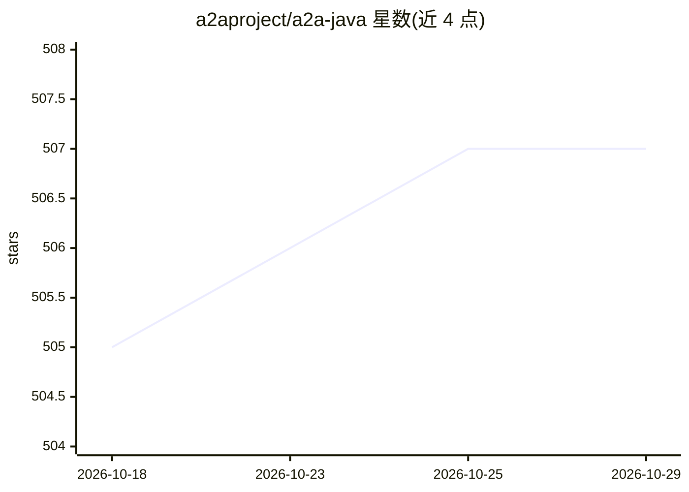

# a2aproject/a2a-java

⭐ 507 · Java · Apache-2.0 · 推送 2026-10-28 · [GitHub](https://github.com/a2aproject/a2a-java) · [官网](https://a2aproject.github.io/a2a-java/) · 组织维护

**Java 开发者的 A2A 协议 SDK：实现 agent 间通信客户端与服务端**

Agent2Agent (A2A) 协议的官方 Java SDK，多模块 Maven 库，提供客户端与服务端支持，覆盖 JSON-RPC、gRPC 与 REST 三种传输。开发者可将自己的 Java agentic 应用运行为 A2A 服务器，或与任意 A2A 兼容 agent 通信。要求 Java 17+，通过 Maven 依赖引入；社区提供 Quarkus 与 Jakarta EE 运行时集成，extras 目录含 OpenTelemetry、JPA 任务存储、Kafka 队列管理器等可选组件。

## 筛选速览

| 维度 | 判定 | 备注 |
|---|---|---|
| AI 角色 | `ai-ecosystem` | LLM/agent 周边工具 |
| 许可风险 | `permissive` | Apache-2.0 |
| 部署形态 | `None` |  |
| 模型依赖 | — | README 未给出锁定关系 |
| 硬件要求 | — | 无带数字的原话,不猜 |
| 安装摩擦 | `medium` | 含编译或系统依赖之一 |
| 成熟度 | — | 结构信号不足 |

## 能力要点

- 客户端/服务端支持 JSON-RPC、gRPC、REST 三种传输
- 多模块 Maven 库，Java 17+
- Quarkus 参考实现与 Jakarta EE 社区集成
- 可选组件：OpenTelemetry、JPA 任务存储、Kafka 复制队列、Vert.x/Android HTTP 客户端

## 适用场景

- 把 Java agentic 应用暴露为 A2A 服务器供其他 agent 调用
- 编写 Java 客户端与任意 A2A 兼容 agent 通信
- 在 Quarkus 或 Jakarta EE 运行时中集成 A2A 协议

## 场景标签

`Agent 框架` · 领域:Agent 开发

## 证据(README 行号)

> L9:  A Java library that helps run agentic applications as A2A servers following the Agent2Agent (A2A) Protocol.
> L12: A multi-module Maven library providing client and server support for A2A agent communication over JSON-RPC, gRPC, a

## 星数曲线

2026-10-18 505 → 2026-10-29 507（+2）

---
*卡片 v1 · prompt 1.4 · 生成 2026-10-21 · 置信度 high · 依据 README sha `3559b5250d80` · [字段定义](../../DATASET.md)*
