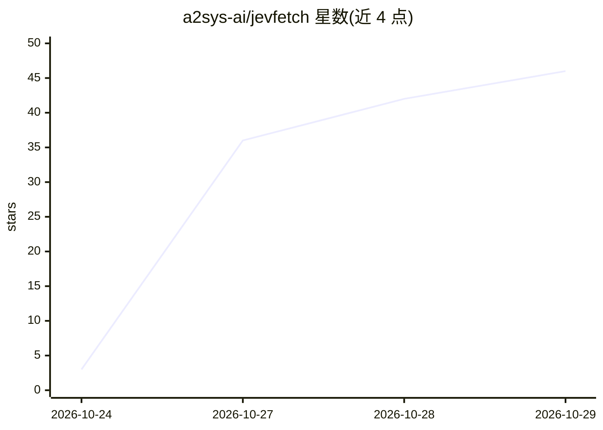

# a2sys-ai/jevfetch

⭐ 46 · Python · MIT · 推送 2026-10-26 · [GitHub](https://github.com/a2sys-ai/jevfetch) · 组织维护 · 中文 README

**给编码代理的网页读取工具：按问题逐字返回页面相关片段**

面向 Claude Code、Codex 等编码代理的网页读取工具：将页面切分为带标题路径的块，调用 TypeSafe 的 Jev 模型判断每块是否回答问题，把判定命中的块连同首块逐字返回给代理，以减少上下文占用并保留可引用原文。支持 skills CLI 一键安装到多种代理，也提供命令行（uv tool install）与 Python API。局限：需 TypeSafe API key（页面文本与问题会发送到 TypeSafe API）；不适于摘要、翻译与整页场景；PDF 等二进制文件仅保存不选段。

## 筛选速览

| 维度 | 判定 | 备注 |
|---|---|---|
| AI 角色 | `ai-ecosystem` | LLM/agent 周边工具 |
| 许可风险 | `permissive` | MIT |
| 部署形态 | `library` | 以包/库形式分发 |
| 模型依赖 | — | README 未给出锁定关系 |
| 硬件要求 | — | 无带数字的原话,不猜 |
| 安装摩擦 | `low` | 无编译、无系统依赖或容器化 |
| 成熟度 | — | 结构信号不足 |

## 能力要点

- 页面分块并用 Jev 模型判定哪些块回答问题，逐字引用返回
- 输出附带标题路径，短页（≤2,000 token）整页直通
- 通过 skills CLI 安装到 Claude Code、Codex 等代理，或以 CLI/Python API 单独使用
- 静态 HTML 文本不足时回退 headless Chrome 渲染 JavaScript 页面

## 适用场景

- 让编码代理在长文档页中查找特定事实并引用原文
- 减少代理读取网页时的上下文 token 消耗
- 替代代理默认的 WebFetch 阅读方式（可配置禁用 WebFetch）

## 场景标签

`网页抓取` `语义搜索` · 领域:效率与自动化

## 证据(README 行号)

> L3: **A web-page reader for coding agents such as Claude Code and Codex: it returns the parts of a page relevant to the 
> L24: jevfetch splits the page into blocks and asks TypeSafe's judgment model Jev whether each block answers the question

## 星数曲线

2026-10-24 3 → 2026-10-29 46（+43）

---
*卡片 v1 · prompt 1.4 · 生成 2026-10-27 · 置信度 high · 依据 README sha `a41bba60d3b6` · [字段定义](../../DATASET.md)*
