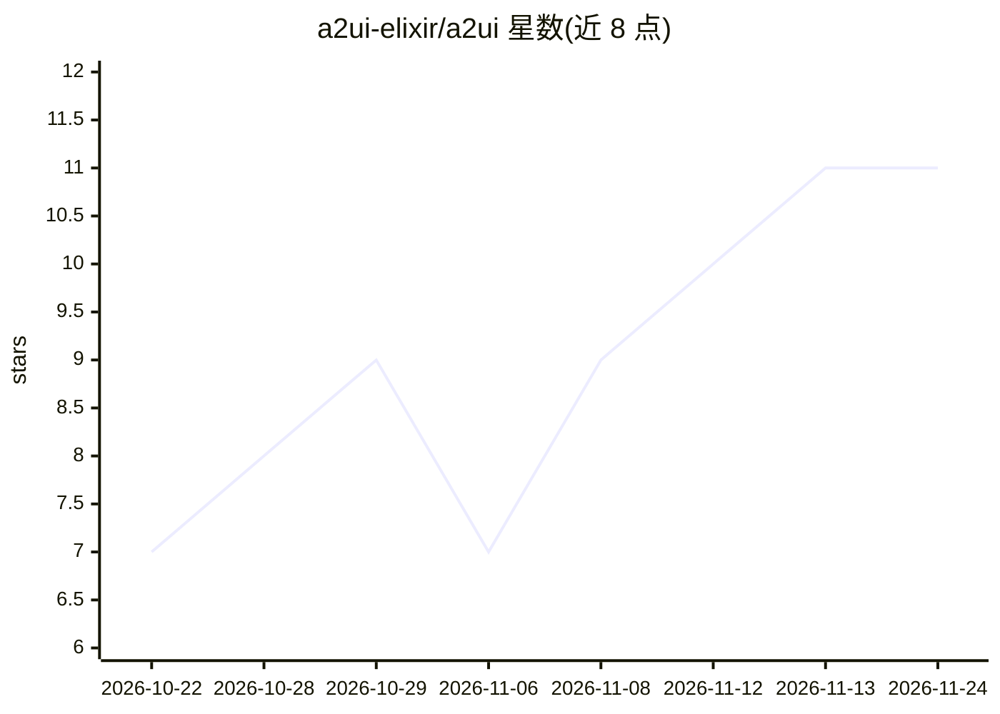

# a2ui-elixir/a2ui

⭐ 12 · Elixir · Apache-2.0 · 推送 2026-10-17 · [GitHub](https://github.com/a2ui-elixir/a2ui) · [官网](https://a2ui-elixir.github.io/a2ui/) · 组织维护

**给 Elixir/Phoenix 开发者的 agent 驱动界面协议实现**

A2UI 协议的 Elixir 实现：agent 以数据形式发送界面，Phoenix 应用用自身信任的组件渲染，并将用户操作回传。提供三个包：a2ui_core（协议引擎，仅依赖 Jason）、a2ui_phoenix（LiveView 渲染器，基于函数组件与服务端事件）、a2ui_agent（agent SDK，含目录协商、流式模型输出解析、经 A2A/MCP/AG-UI 提供）。支持协议 v0.9/v0.9.1/v1.0，对照上游一致性套件测试。Apache-2.0 许可。

## 筛选速览

| 维度 | 判定 | 备注 |
|---|---|---|
| AI 角色 | `ai-ecosystem` | LLM/agent 周边工具 |
| 许可风险 | `permissive` | Apache-2.0 |
| 部署形态 | `None` |  |
| 模型依赖 | — | README 未给出锁定关系 |
| 硬件要求 | — | 无带数字的原话,不猜 |
| 安装摩擦 | `low` | 无编译、无系统依赖或容器化 |
| 成熟度 | — | 结构信号不足 |

## 能力要点

- 三个 Hex 包：core 协议引擎、Phoenix LiveView 渲染器、agent SDK
- 支持协议 v0.9、v0.9.1、v1.0 及上游一致性套件
- agent 经 A2A、MCP、AG-UI 与 SSE/WebSocket 提供服务
- 流式模型输出的校验解析与目录协商

## 适用场景

- 在 Phoenix LiveView 应用中渲染 agent 生成的界面
- 将 Elixir agent 经 A2A/MCP 供外部客户端使用
- 在终端中渲染 agent 界面（terminal_client 示例）

## 场景标签

`Agent 框架` · 领域:Agent 开发

## 证据(README 行号)

> L11: An Elixir implementation of A2UI, the open protocol for
> L29: |`a2ui_agent`|The agent SDK: catalog negotiation, prompts in the direct JSON and Express formats, validated parsing
> L82: |`restaurant_agent`|An agent that finds restaurants and books tables, served over A2A, MCP, AG-UI, server-sent even

## 星数曲线

2026-10-22 7 → 2026-11-24 11（+4）

---
*卡片 v1 · prompt 1.4 · 生成 2026-11-18 · 置信度 high · 依据 README sha `b0a6dd369f95` · [字段定义](../../DATASET.md)*
