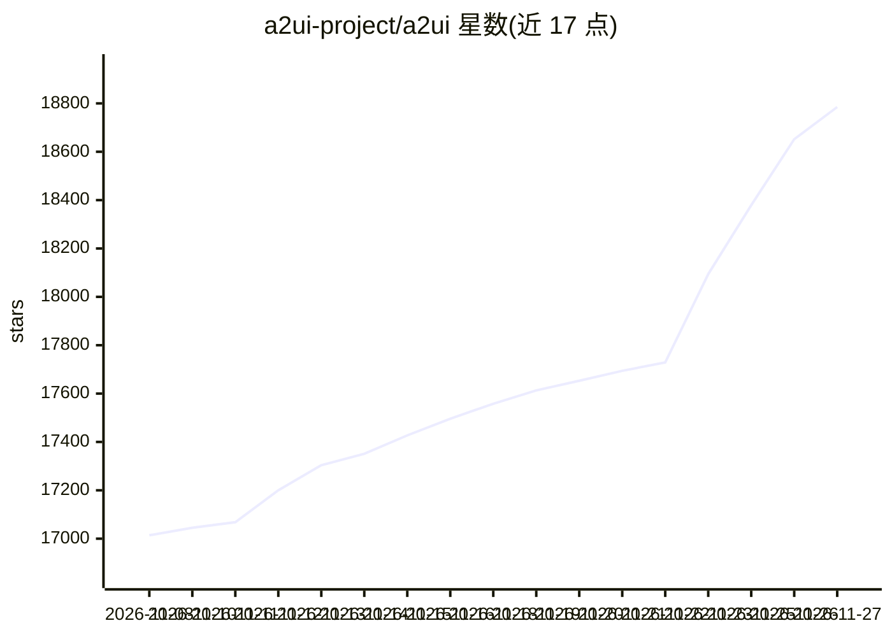

# a2ui-project/a2ui

⭐ 18,785 · TypeScript · Apache-2.0 · 推送 2026-11-26 · [GitHub](https://github.com/a2ui-project/a2ui) · [官网](https://a2ui.org/) · 组织维护

**为开发者提供 agent 流式生成原生 UI 的框架**

A2UI（Agent-to-User Interface）是一个开源生成式 UI 框架，包含低延迟流式 UI 协议、多框架原生渲染器（React/Angular/Lit/Flutter/SwiftUI/Jetpack Compose）以及多语言 Agent SDK。Agent 以数据形式（受 schema 校验约束、不含可执行代码）表达 UI，应用用原生组件渲染。适用于 agent 驱动、远程渲染与跨信任边界的场景；未发布的包可从源码使用。

## 筛选速览

| 维度 | 判定 | 备注 |
|---|---|---|
| AI 角色 | `ai-ecosystem` | LLM/agent 周边工具 |
| 许可风险 | `permissive` | Apache-2.0 |
| 部署形态 | `library` | 以包/库形式分发 |
| 模型依赖 | — | README 未给出锁定关系 |
| 硬件要求 | — | 无带数字的原话,不猜 |
| 安装摩擦 | `low` | 无编译、无系统依赖或容器化 |
| 成熟度 | — | 结构信号不足 |

## 能力要点

- UI 以数据表达并经 schema 校验，禁止任意可执行代码
- 支持渐进式流式渲染与可替换推理格式
- 为 React、Angular、Lit、Flutter、SwiftUI 等提供原生渲染器
- 提供 Python/TypeScript/Dart/Swift 的 Agent SDK 与 MCP 目录

## 适用场景

- 让 agent 以原生组件而非纯文本与用户交互
- 同一 agent 跨多平台流式输出一致 UI
- 第三方 agent 需跨信任边界渲染 UI 且不接触敏感数据

## 场景标签

`Agent 框架` · 领域:Agent 开发

## 证据(README 行号)

> L5: A2UI (Agent-to-User Interface) is an open-source generative UI framework,
> L91: 2. **Transport**: An A2UI Agent SDK, embedded in a larger agent architecture,
> L124: |a2ui-agent-sdk|Agent SDK: negotiates catalogs, generates prompts and skills, and compiles model output into A2UI.

## 星数曲线

2026-11-08 17,014 → 2026-11-27 18,785（+1,771）

---
*卡片 v1 · prompt 1.4 · 生成 2026-11-26 · 置信度 high · 依据 README sha `4622fae28bdb` · [字段定义](../../DATASET.md)*
