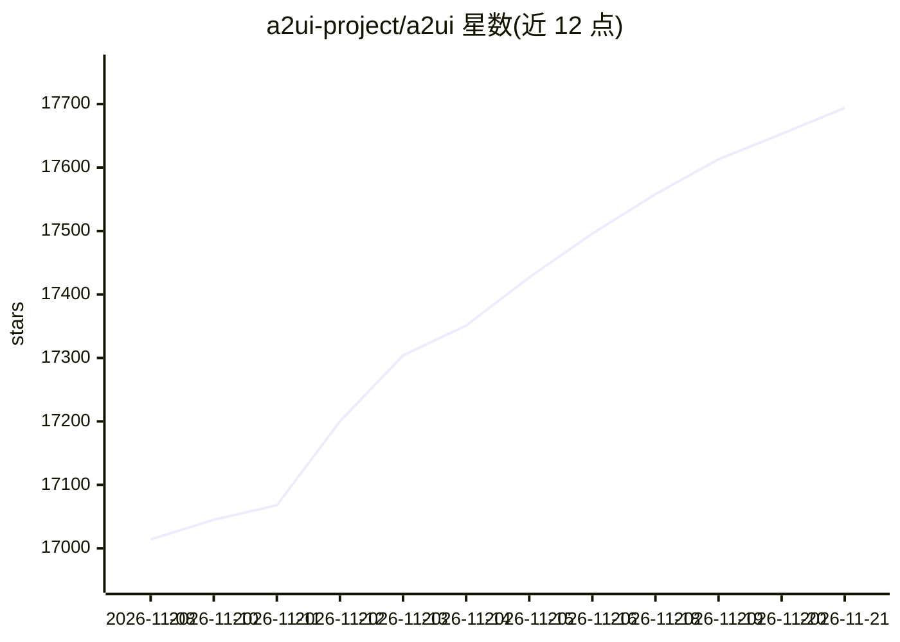

# a2ui-project/a2ui

⭐ 17,694 · TypeScript · Apache-2.0 · 推送 2026-11-20 · [GitHub](https://github.com/a2ui-project/a2ui) · [官网](https://a2ui.org/) · 组织维护

**开源生成式 UI 框架：agent 流式输出界面数据，原生渲染**

A2UI 是开源生成式 UI 框架，由协议、原生渲染器与多语言 Agent SDK 组成：agent（LLM 或决策模型）按 schema 以数据而非代码生成 UI 描述，经 A2UI Transport 协议流式传输到渲染端，由 React、Angular、Lit、Flutter、SwiftUI、Jetpack Compose 等框架的原生组件渲染。面向构建 agent 应用的开发者，通过严格 schema 与能力目录约束 agent 可用组件，支持跨平台一致 UI。提供 Python/TypeScript/Dart/Swift 多语言包。

## 筛选速览

| 维度 | 判定 | 备注 |
|---|---|---|
| AI 角色 | `ai-ecosystem` | LLM/agent 周边工具 |
| 许可风险 | `permissive` | Apache-2.0 |
| 部署形态 | `library` | 以包/库形式分发 |
| 模型依赖 | — | README 未给出锁定关系 |
| 硬件要求 | — | 无带数字的原话,不猜 |
| 安装摩擦 | `low` | 无编译、无系统依赖或容器化 |
| 成熟度 | — | 结构信号不足 |

## 能力要点

- UI 以数据而非代码表达，schema 校验并约束 agent 能力边界
- 支持 React/Angular/Lit/Flutter/SwiftUI/Jetpack Compose 原生渲染
- 流式渐进渲染协议，支持可替换推理格式
- 多语言 Agent SDK 与 MCP、A2A、ADK 集成包

## 适用场景

- 让应用的 agent 动态生成界面并流式渲染到原生组件
- 同一 agent 向多个平台/框架输出一致的用户体验
- 在信任边界上限制 agent 可访问的组件与数据类型

## 场景标签

`Agent 框架` · 领域:Agent 开发

## 证据(README 行号)

> L5: A2UI (Agent-to-User Interface) is an open-source generative UI framework,
> L86: 1. **Inference**: An agent (typically backed by a language or a decision model)

## 星数曲线

2026-11-08 17,014 → 2026-11-21 17,694（+680）

---
*卡片 v1 · prompt 1.4 · 生成 2026-11-17 · 置信度 high · 依据 README sha `90e6edd320ec` · [字段定义](../../DATASET.md)*
