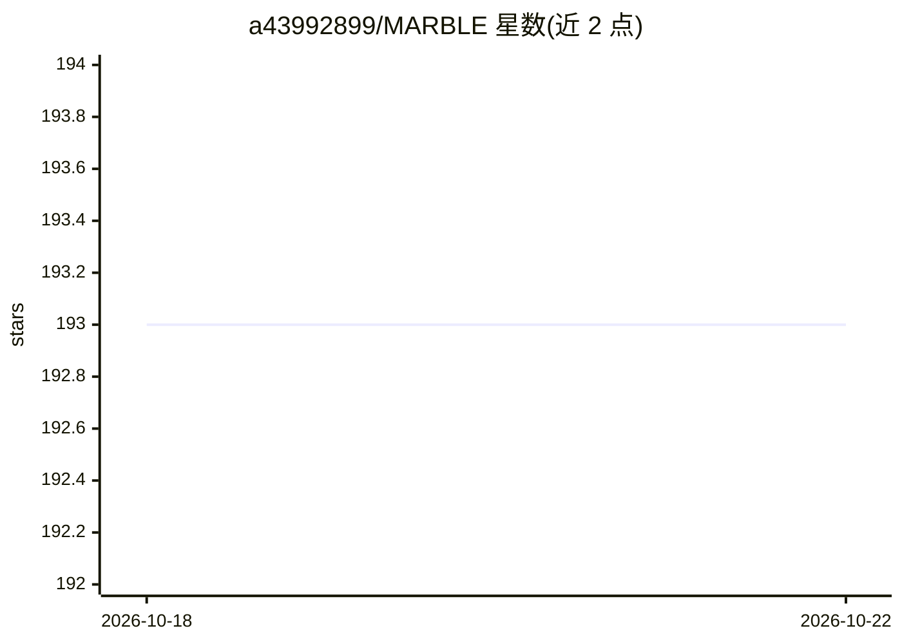

# a43992899/MARBLE

⭐ 193 · Python · 推送 2026-08-29 · [GitHub](https://github.com/a43992899/MARBLE) · 组织维护

**面向 MIR 研究者的预训练音乐模型训练/评测/推理套件**

模块化、配置驱动的音乐理解模型套件，基于 LightningCLI 实现训练、评测与推理。封装 CLaMP3、MERT、MuQ、DaSheng、Qwen2-Audio 等编码器，覆盖和弦识别、调性检测、流派/情绪标注、旋律预测等约 20 个下游任务；实验由 YAML 配置驱动，新编码器/任务通过子类与配置注册扩展。提供 Hugging Face 模型自动下载的调性预测推理脚本，与 MIREX 合作维护。安装通过 conda 环境 + 依赖脚本，训练结果记录至 Weights & Biases。

## 筛选速览

| 维度 | 判定 | 备注 |
|---|---|---|
| AI 角色 | `ai-ecosystem` | LLM/agent 周边工具 |
| 许可风险 | `none` | — |
| 部署形态 | `None` |  |
| 模型依赖 | — | README 未给出锁定关系 |
| 硬件要求 | — | 无带数字的原话,不猜 |
| 安装摩擦 | `low` | 无编译、无系统依赖或容器化 |
| 成熟度 | — | 结构信号不足 |

## 能力要点

- 支持 10 种预训练编码器（CLaMP3/MERT/MuQ/Qwen2-Audio 等）可组合接入
- 约 20 个 MIR 下游任务（流派、和弦、调性、情绪、旋律、深度伪造检测等）
- YAML 配置驱动实验，编码器/任务支持内部与外部两种扩展模式
- 提供调性预测推理脚本，模型自动从 Hugging Face 下载

## 适用场景

- 在标准数据集上评测不同预训练音乐模型的下游任务表现
- 复现或扩展 SSL 音乐理解模型的探测/微调实验
- 对音频文件批量运行 SOTA 调性预测推理

## 场景标签

 · 领域:音乐信息检索（MIR）/深度学习

## 证据(README 行号)

> L3:  State-of-the-art pretrained music models for training, evaluation, inference
> L5: Marble is a modular, configuration-driven suite for training, evaluating, and performing inference on state-of-the-a
> L45: 5. **Results**: Checkpoints and logs will be saved under `output/` and logged in Weights & Biases.

## 星数曲线

2026-10-18 193 → 2026-10-22 193（+0）

---
*卡片 v1 · prompt 1.4 · 生成 2026-10-22 · 置信度 high · 依据 README sha `f71e9d331a1f` · [字段定义](../../DATASET.md)*
