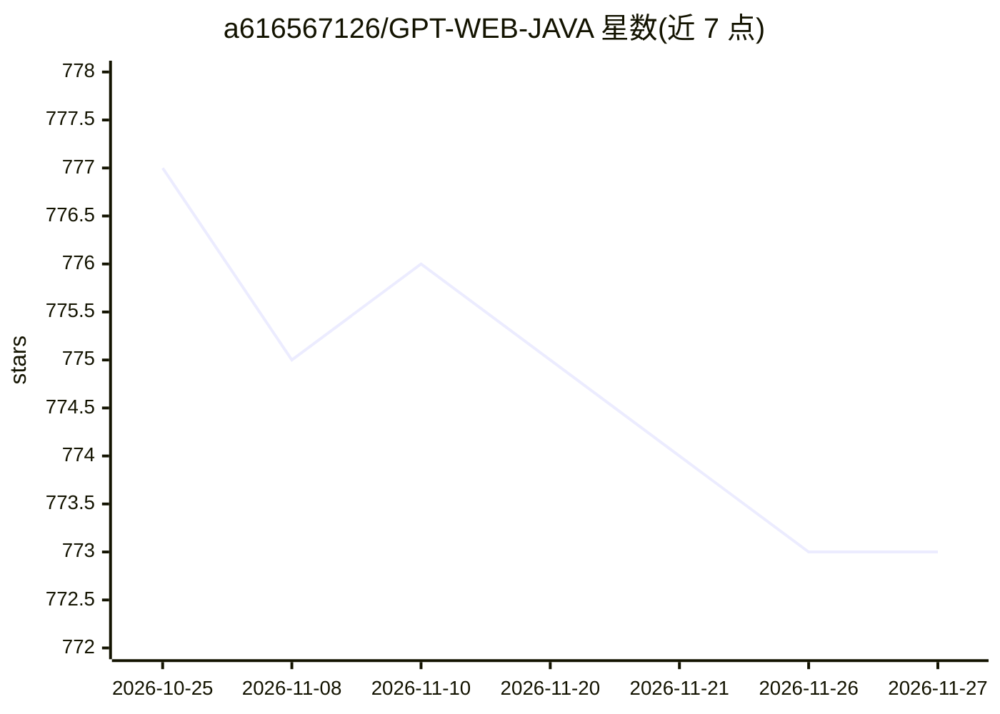

# a616567126/GPT-WEB-JAVA

⭐ 773 · Java · Apache-2.0 · 推送 2026-11-18 · [GitHub](https://github.com/a616567126/GPT-WEB-JAVA) · 个人维护 · 中文 README

**面向搭建付费 AI 问答网站的 Java 系统：对话、画图与支付一体化**

基于 JDK8 + MySQL + Redis 的 Java Web 项目，部署后向终端用户提供 ChatGPT 对话（SSE WebSocket 流式推送，支持官方/第三方 API 地址、GPT4.0 图片识别、DALL-E 3）、星火大模型、Midjourney 画图（/imagine、/describe、垫图、账号池）与 Stable-Diffusion 画图（模型/Lora 选择、高清修复）。含用户中心、百度翻译与内容审核、本地或阿里云 OSS 图片存储。商业机制包括易支付、微信支付与卡密兑换；README 提示购买后加入 VIP 群获取更新。

## 筛选速览

| 维度 | 判定 | 备注 |
|---|---|---|
| AI 角色 | `ai-native` | 本体是模型或模型工具 |
| 许可风险 | `permissive` | Apache-2.0 |
| 部署形态 | `None` |  |
| 模型依赖 | — | README 未给出锁定关系 |
| 硬件要求 | — | 无带数字的原话,不猜 |
| 安装摩擦 | `low` | 无编译、无系统依赖或容器化 |
| 成熟度 | — | 结构信号不足 |

## 能力要点

- GPT 与星火大模型的 SSE WebSocket 流式对话，支持官方/第三方 API 地址
- Midjourney 全套画图操作（/imagine、/describe、/blend、账号池管理）
- Stable-Diffusion 模型与 Lora 配置，支持本地 127.0.0.1:7860 地址
- 商业闭环：易支付、微信支付、卡密兑换

## 适用场景

- 自建面向公众号引流的 ChatGPT 网页问答站
- 为用户提供 Midjourney 与 SD 画图服务并通过卡密收费
- 对接星火大模型做国内可访问的对话服务

## 场景标签

`聊天机器人` `图像生成` · 领域:对话与助手

## 证据(README 行号)

> L21: - [x] **GPT 对话**：基于 SSE WebSocket 流式推送，支持 3.5、4.0 等全模型系列，支持官方/第三方 API 地址，支持 GPT4.0 图片识别、DALL-E 3 画图模型。
> L26: - [x] **商业闭环**：产品查询与购买，集成**易支付**、**卡密兑换**、**微信支付**。

## 星数曲线

2026-10-25 777 → 2026-11-27 773（-4）

---
*卡片 v1 · prompt 1.4 · 生成 2026-11-24 · 置信度 high · 依据 README sha `19fd3985c869` · [字段定义](../../DATASET.md)*
