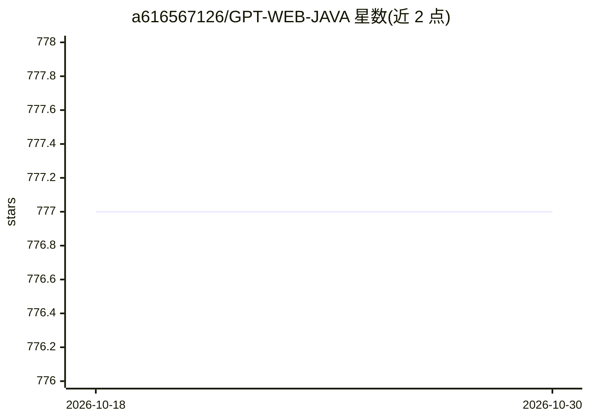

# a616567126/GPT-WEB-JAVA

⭐ 777 · Java · Apache-2.0 · 推送 2026-09-18 · [GitHub](https://github.com/a616567126/GPT-WEB-JAVA) · 个人维护 · 中文 README

**Java 商用 AI 聊天机器人系统：GPT 对话与多引擎画图**

基于 JDK8 + MySQL + Redis 的 AI 聊天机器人 Web 系统，提供用户中心与管理后台（3.0 UI 移动端适配）。功能覆盖 GPT 对话（SSE/WebSocket 流式，3.5/4.0 系列，支持官方或第三方 API 地址）、星火大模型、Midjourney 画图（imagine/describe/U/V/变换等操作与账号池）、Stable-Diffusion 画图（模型/Lora 选择、高清修复）。商业闭环包含易支付、卡密兑换、微信支付。限制：README 未提供安装运行命令，演示地址已关闭；源码免费但 VIP 群与持续更新需付费购买。

## 筛选速览

| 维度 | 判定 | 备注 |
|---|---|---|
| AI 角色 | `ai-native` | 本体是模型或模型工具 |
| 许可风险 | `permissive` | Apache-2.0 |
| 部署形态 | `None` |  |
| 模型依赖 | — | README 未给出锁定关系 |
| 硬件要求 | — | 无带数字的原话,不猜 |
| 安装摩擦 | `low` | 无编译、无系统依赖或容器化 |
| 成熟度 | — | 结构信号不足 |

## 能力要点

- GPT 对话 SSE/WebSocket 流式推送，支持 3.5/4.0 全模型与第三方 API 地址
- Midjourney 画图支持 imagine/describe/blend/U 放大/V 变换/账号池管理
- Stable-Diffusion 画图支持模型/Lora 选择与高清修复
- 商业闭环：易支付、卡密兑换、微信支付与图片存储（本地/阿里云 OSS）

## 适用场景

- 搭建面向公众的付费 AI 聊天与画图服务站点
- 通过卡密兑换和支付渠道实现 AI 能力售卖
- 在微信公众号/移动端提供 GPT 对话与 Midjourney 出图

## 场景标签

`聊天机器人` `图像生成` · 领域:对话与助手

## 证据(README 行号)

> L21: - [x] **GPT 对话**：基于 SSE WebSocket 流式推送，支持 3.5、4.0 等全模型系列，支持官方/第三方 API 地址，支持 GPT4.0 图片识别、DALL-E 3 画图模型。
> L23: - [x] **Midjourney 画图**：支持 `/imagine` (文生图)、`/describe` (图生文)、重做、`--relax`、`--fast` (切换出图模式)、U 放大、V 变换、Strong、Subtl
> L26: - [x] **商业闭环**：产品查询与购买，集成**易支付**、**卡密兑换**、**微信支付**。

## 星数曲线

2026-10-18 777 → 2026-10-30 777（+0）

---
*卡片 v1 · prompt 1.4 · 生成 2026-10-21 · 置信度 high · 依据 README sha `b5593842367c` · [字段定义](../../DATASET.md)*
