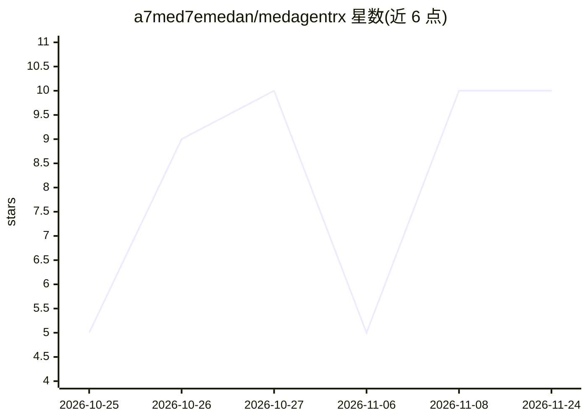

# a7med7emedan/medagentrx

⭐ 10 · Python · Apache-2.0 · 推送 2026-11-23 · [GitHub](https://github.com/a7med7emedan/medagentrx) · [官网](https://a7med7emedan.github.io/medagentrx/) · 个人维护

**给临床 AI 模型更新做变更控制审查的 Python 门禁工具**

将预定的变更控制计划（FDA PCCP / EU AI Act 第 43(4) 条）转化为在每次模型更新时运行的测试：更新由工程师、流水线或 AI agent 提交，按 YAML 计划评估后给出 ACCEPTED / FAILED / OUTSIDE_PLAN 三种裁决。评估覆盖 23 项检查（数据完整性、AUROC 与 DeLong 检验、校准、净收益、亚组非劣性、模型卡、部署 QC），全部尝试写入哈希链账本并消耗锁定测试集的查看预算，防止多次尝试后的选择性通过。仅读取预测文件，不加载模型二进制；提供 HTML/JSON/Markdown/JUnit XML 报告与证据打包。

## 筛选速览

| 维度 | 判定 | 备注 |
|---|---|---|
| AI 角色 | `ai-ecosystem` | LLM/agent 周边工具 |
| 许可风险 | `permissive` | Apache-2.0 |
| 部署形态 | `library` | 以包/库形式分发 |
| 模型依赖 | — | README 未给出锁定关系 |
| 硬件要求 | — | 无带数字的原话,不猜 |
| 安装摩擦 | `low` | 无编译、无系统依赖或容器化 |
| 成熟度 | — | 结构信号不足 |

## 能力要点

- 23 项检查映射法规条款，输出三类裁决与退出码
- 哈希链账本记录每次尝试并管理测试集查看预算
- thresholdout 模式限制 agent 反复试探泄露测试集信息
- 证据包（plan+账本+报告+SHA-256 清单）供审查者一条命令核验

## 适用场景

- 对已被监管批准的模型进行自动化再训练并在每次更新时核验合规
- 让 AI agent 提交候选更新并限制其可执行的修改范围
- 定期对线上系统做部署 QC，检测未申报的运行时或硬件变更
- 向监管审查者提交可验证的证据包

## 场景标签

`MLOps` `模型评测` · 领域:评测与运维

## 证据(README 行号)

> L13: Clinical risk models are increasingly retrained by scheduled pipelines and by AI agents. Regulators allow this only
> L15: The plan is a single YAML file. Each candidate update is evaluated against it and receives one verdict: **ACCEPTED*
> L59: The exit code is the verdict: 0 ACCEPTED, 1 FAILED, 2 OUTSIDE_PLAN, 3 input error. `report/` holds a self-contained

## 星数曲线

2026-10-25 5 → 2026-11-24 10（+5）

---
*卡片 v1 · prompt 1.4 · 生成 2026-11-20 · 置信度 high · 依据 README sha `46c352066764` · [字段定义](../../DATASET.md)*
