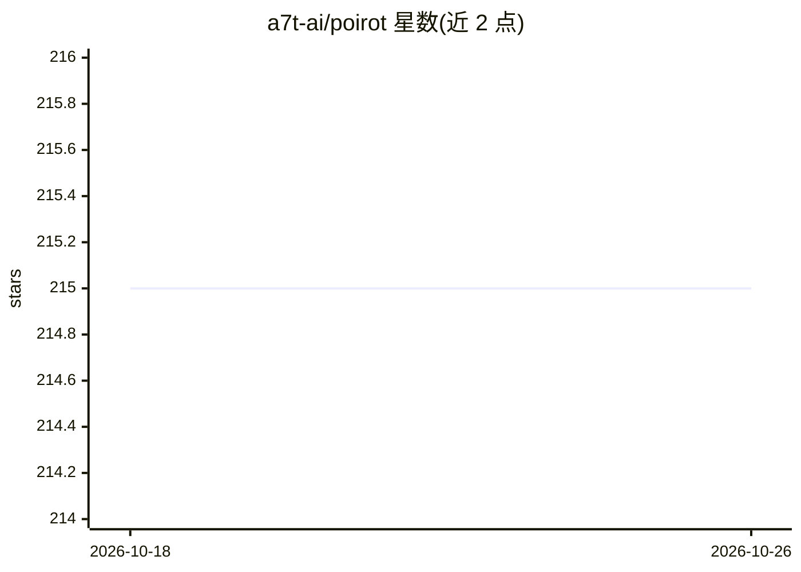

# a7t-ai/poirot

⭐ 215 · Swift · MIT · 推送 2026-10-10 · [GitHub](https://github.com/a7t-ai/poirot) · [官网](https://poirot.fyi) · 组织维护

**macOS 原生应用：浏览与审计 Claude Code 会话记录**

用 SwiftUI 编写的 macOS 桌面应用，读取 Claude Code 本地存储（~/.claude/ 目录）的 JSONL 会话记录，提供会话历史浏览、对话时间线渲染、代码 diff 查看、token/成本统计、订阅限额仪表、模糊搜索、子代理与命令/技能/MCP 配置管理等。无需登录、离线工作、体积小于 6MB。通过 Homebrew Cask 分发，也可用 Xcode 从源码构建（需 macOS 15+、Xcode 16+）。

## 筛选速览

| 维度 | 判定 | 备注 |
|---|---|---|
| AI 角色 | `ai-ecosystem` | LLM/agent 周边工具 |
| 许可风险 | `permissive` | MIT |
| 部署形态 | `None` |  |
| 模型依赖 | locked-api |  |
| 硬件要求 | — | 无带数字的原话,不猜 |
| 安装摩擦 | `medium` | 含编译或系统依赖之一 |
| 成熟度 | — | 结构信号不足 |

## 能力要点

- 解析 ~/.claude/ 下 JSONL 会话记录并按项目分组浏览
- 会话分析：token 消耗、成本拆分、模型分布与订阅限额仪表
- 模糊搜索（⌘K）覆盖会话、摘要、历史、命令、技能等
- 一键在 VS Code/Cursor/Xcode/Zed 打开文件或在所选终端重跑命令

## 适用场景

- 回看和检索 Claude Code 的历史会话与工具调用
- 查看 token 用量、成本与订阅限额使用情况
- 管理 Claude Code 的子代理、命令、技能与 MCP 配置
- 导出会话为 Markdown 或 PDF

## 场景标签

`LLM 可观测性` · 领域:评测与运维

## 证据(README 行号)

> L3:  Investigating your Claude Code sessions.
> L204: ~/.claude/projects/          Poirot reads JSONL transcripts

## 星数曲线

2026-10-18 215 → 2026-10-26 215（+0）

---
*卡片 v1 · prompt 1.4 · 生成 2026-10-22 · 置信度 high · 依据 README sha `a8f86ebad9ee` · [字段定义](../../DATASET.md)*
