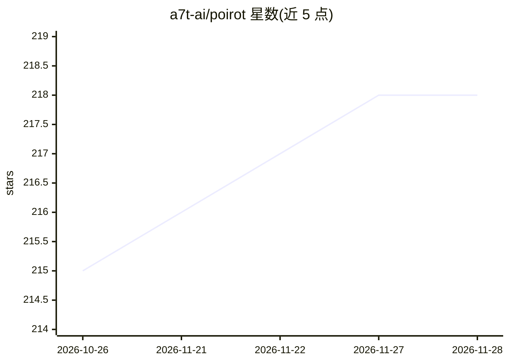

# a7t-ai/poirot

⭐ 218 · Swift · MIT · 推送 2026-10-27 · [GitHub](https://github.com/a7t-ai/poirot) · [官网](https://poirot.fyi) · 个人维护

**为 Claude Code 用户提供会话浏览/差异查看/命令重跑的 macOS 原生伴侣应用**

基于 SwiftUI 的原生 macOS 应用，读取 Claude Code 本地存储（~/.claude/）的 JSONL 会话记录、调试日志、历史与 facets 数据，提供会话分析（token 消耗、成本、模型分布）、对话时间线渲染、diff 查看、⌘K 模糊搜索、子代理/MCP 服务器/技能/Hooks 等配置管理，以及一键在终端重跑命令。无需登录、离线运行、复用 Claude Code 已存 token 读取用量限额。要求 macOS 15+，通过 Homebrew cask 安装或 Xcode 源码构建。

## 筛选速览

| 维度 | 判定 | 备注 |
|---|---|---|
| AI 角色 | `ai-ecosystem` | LLM/agent 周边工具 |
| 许可风险 | `permissive` | MIT |
| 部署形态 | `None` |  |
| 模型依赖 | — | README 未给出锁定关系 |
| 硬件要求 | — | 无带数字的原话,不猜 |
| 安装摩擦 | `medium` | 含编译或系统依赖之一 |
| 成熟度 | `idea` | |

## 能力要点

- 解析 ~/.claude/projects/ 的 JSONL 会话记录为结构化模型
- 会话分析仪表盘：token 消耗、成本明细、模型分布
- 子代理创建/编辑/管理，支持 JSON 导入导出
- 会话导出为 Markdown 或 PDF，一键打开 VS Code/Cursor/Xcode/Zed

## 适用场景

- 浏览和检索历史 Claude Code 会话记录
- 排查调试日志、快速定位并重跑失败的 Bash 命令
- 查看订阅用量限额与 token 成本趋势
- 管理子代理、MCP 服务器与 slash 命令配置

## 场景标签

 · 领域:开发者工具/AI 编程辅助

## 证据(README 行号)

> L4:  A native macOS companion that lets you browse sessions, explore diffs, and re-run commands — all from a polished Sw
> L70: |**Sessions**|JSONL Transcript Parser|Parses `~/.claude/projects/` transcripts into structured models|
> L130: ||Provider System|Extensible `ProviderDescribing` protocol for multi-LLM support|

## 星数曲线

2026-10-26 215 → 2026-11-28 218（+3）

---
*卡片 v1 · prompt 1.4 · 生成 2026-11-25 · 置信度 high · 依据 README sha `937185ff579d` · [字段定义](../../DATASET.md)*
