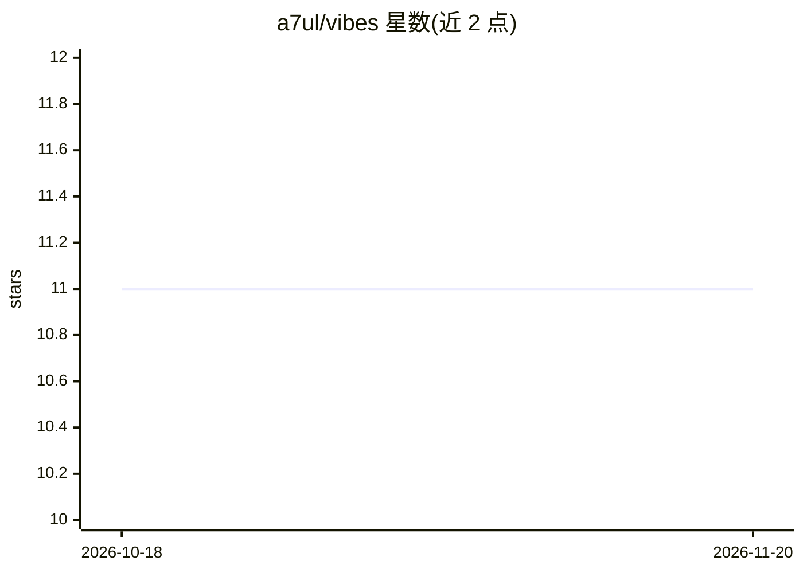

# a7ul/vibes

⭐ 11 · TypeScript · 推送 2026-07-08 · [GitHub](https://github.com/a7ul/vibes) · [官网](https://vibes-sdk.a7ul.com) · 个人维护

**TypeScript agent 框架：以类型安全方式构建生产级 AI 应用**

受 Pydantic AI 启发的 TypeScript agent 框架，模型层基于 Vercel AI SDK，面向 JS/TS 开发者。核心机制：Agent 即函数，工具参数经 Zod 运行时校验并通过 RunContext 做依赖注入；支持结构化输出、流式部分对象、验证失败重试与 token 预算控制、无真实 API 调用的 TestModel 测试与 LLM-as-judge 评测、OpenTelemetry 可观测性，以及基于 Temporal 的持久化 agent。通过 JSR 分发，同时提供供编码助手使用的 agent skill 与 MCP 文档服务器。

## 筛选速览

| 维度 | 判定 | 备注 |
|---|---|---|
| AI 角色 | `ai-ecosystem` | LLM/agent 周边工具 |
| 许可风险 | `permissive` | — |
| 部署形态 | `library` | 以包/库形式分发 |
| 模型依赖 | local-ok | 支持本地模型 |
| 硬件要求 | — | 无带数字的原话,不猜 |
| 安装摩擦 | `low` | 无编译、无系统依赖或容器化 |
| 成熟度 | — | 结构信号不足 |

## 能力要点

- 类型安全工具 + 依赖注入（Zod 运行时校验，RunContext 传递依赖）
- CI 内无真实 API 调用的 agent 测试与类型化评测框架
- 经 Vercel AI SDK 支持 50+ provider，切换为一行改动
- OTel 可观测性与基于 Temporal 的持久化 agent

## 适用场景

- 在 TypeScript 项目中构建带类型安全工具调用的 agent
- 为 agent 编写 CI 回归测试与 LLM 评测
- 构建支持流式结构化输出的 LLM 应用
- 在多个 LLM provider 间按需切换

## 场景标签

`Agent 框架` · 领域:Agent 开发

## 证据(README 行号)

> L3:  TypeScript agent framework for building production-grade, type-safe AI applications — the Pydantic AI way, using Ve
> L78: The core idea is borrowed from Pydantic AI: **agents are just functions**. They take input, call tools, and return 

## 星数曲线

2026-10-18 11 → 2026-11-20 11（+0）

---
*卡片 v1 · prompt 1.4 · 生成 2026-11-18 · 置信度 high · 依据 README sha `28fab888a751` · [字段定义](../../DATASET.md)*
