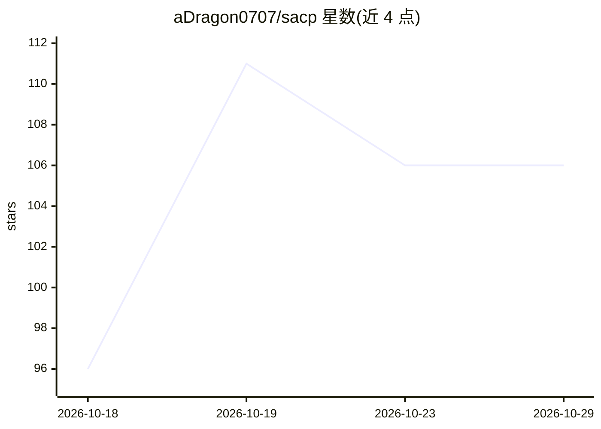

# aDragon0707/sacp

⭐ 106 · Python · MIT · 推送 2026-10-15 · [GitHub](https://github.com/aDragon0707/sacp) · 个人维护 · 中文 README

**核验 AI agent“已完成”声明的协议与 Python 引擎**

面向 agent 工作流交接的协议与参考实现：把完成条件拆为声明、证据、外部系统报告与授权四类，由 Python 引擎推导裁决（Claim→Evidence→Verdict→Gate），供领域门控允许或阻断流程继续。事件经 append-only SQLite API 存储，新证据可改变派生状态且不抹除历史，并记录有界恢复路径。含发布/部署/退款示例、场景回归 harness、协议校验器与 LangGraph 可选适配器。自述为实验性 alpha，证据采集可信性由集成方负责，提供者为 mock 或 localhost 实验。

## 筛选速览

| 维度 | 判定 | 备注 |
|---|---|---|
| AI 角色 | `ai-ecosystem` | LLM/agent 周边工具 |
| 许可风险 | `permissive` | MIT |
| 部署形态 | `library` | 以包/库形式分发 |
| 模型依赖 | — | README 未给出锁定关系 |
| 硬件要求 | — | 无带数字的原话,不猜 |
| 安装摩擦 | `low` | 无编译、无系统依赖或容器化 |
| 成熟度 | `idea` | |

## 能力要点

- Claim→Evidence→Verdict→Gate 四要素核心路径与派生裁决
- append-only SQLite 事件存储，新证据可更新派生状态
- 49/49 严格协议文档校验与 8/8 阻断用例的回归 harness
- 对自身 PR 应用 SHA 绑定回执的审查模式

## 适用场景

- agent 宣称完成发布/部署/通知后，核验证据与授权再决定是否继续流程
- CI 结果、外部系统报告与审批在交接处对齐
- 审计已有 agent 交接或文本回应（AgentOps Doctor 本地启发式）

## 场景标签

`Agent 框架` `LLM 可观测性` · 领域:Agent 开发

## 证据(README 行号)

> L9: SACP (Scalable Audit and Control Protocol) makes completion conditions explicit: what the agent claims, which eviden
> L73: The core path is **Claim → Evidence → Verdict → Gate**. Three layers make it usable and testable:

## 星数曲线

2026-10-18 96 → 2026-10-29 106（+10）

---
*卡片 v1 · prompt 1.4 · 生成 2026-10-23 · 置信度 mid · 依据 README sha `94f0d493f9d3` · [字段定义](../../DATASET.md)*
