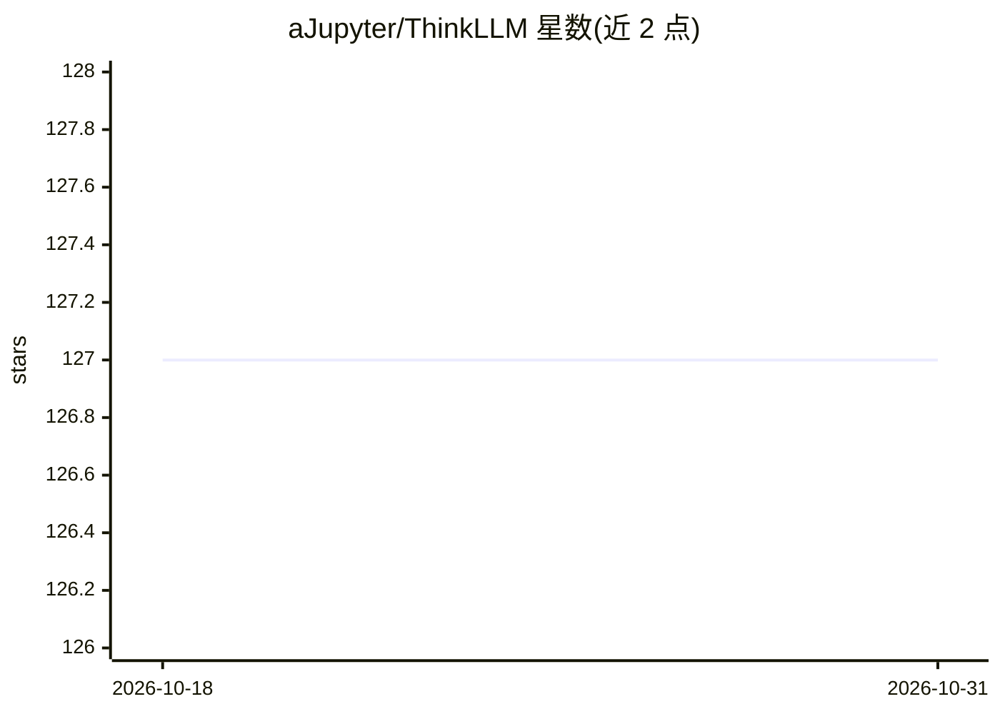

# aJupyter/ThinkLLM

⭐ 127 · Jupyter Notebook · Apache-2.0 · 推送 2026-06-18 · [GitHub](https://github.com/aJupyter/ThinkLLM) · 个人维护 · 中文 README

**面向学习者的 LLM 核心算法从零复现代码集**

开源的大语言模型算法教学项目：以自包含、可独立运行的 Notebook 与脚本形式，从零复现 Transformer 注意力、BPE 分词、ViT 多模态、RAG 向量检索、MoE、PPO/GRPO 损失与 ReAct/CoT/ToT 等 Agent 算法。设计原则是可运行、自包含（不依赖项目内其他文件）、优先 NumPy/朴素 PyTorch 实现。各模块无统一 requirements.txt，通过克隆仓库运行；RAG 模块提供 python -m 一键演示。另含规划中的 Roadmap（RoPE、量化、DPO 等）。

## 筛选速览

| 维度 | 判定 | 备注 |
|---|---|---|
| AI 角色 | `ai-knowledge` | 知识聚合/清单类 |
| 许可风险 | `permissive` | Apache-2.0 |
| 部署形态 | `None` |  |
| 模型依赖 | — | README 未给出锁定关系 |
| 硬件要求 | — | 无带数字的原话,不猜 |
| 安装摩擦 | `low` | 无编译、无系统依赖或容器化 |
| 成熟度 | — | 结构信号不足 |

## 能力要点

- Transformer/MHA/GQA/MQA/线性注意力/FlashAttention 等组件 Notebook 复现
- RAG 算法库：LSH/HNSW 索引、HyDE、混合检索排序、重排序，可一键运行
- PPO/GRPO 损失从零实现（仅依赖 torch+numpy）
- Agent 模块用 mock LLM + 工具 hack 纯标准库跑通 ReAct/CoT/反思/ToT

## 适用场景

- 通过可运行代码理解 LLM 底层算法机制
- 学习 RAG 检索与检索优化算法的实现细节
- 理解 PPO/GRPO 等对齐训练损失的计算过程

## 场景标签

`教程课程` · 领域:学习与行业

## 证据(README 行号)

> L26: **ThinkLLM** 是一个专注于大语言模型核心算法实现的开源项目。我们用尽量少的依赖、尽量简洁的代码，从零复现 LLM / 多模态 / RAG / MoE / RL / Agent 等关键算法与组件，帮助开发者和研究者**通
> L30: - **可运行**：每个模块都是一个可以独立打开就跑的 Notebook 或脚本，而非伪代码。

## 星数曲线

2026-10-18 127 → 2026-10-31 127（+0）

---
*卡片 v1 · prompt 1.4 · 生成 2026-10-23 · 置信度 high · 依据 README sha `aeb29e3638d4` · [字段定义](../../DATASET.md)*
