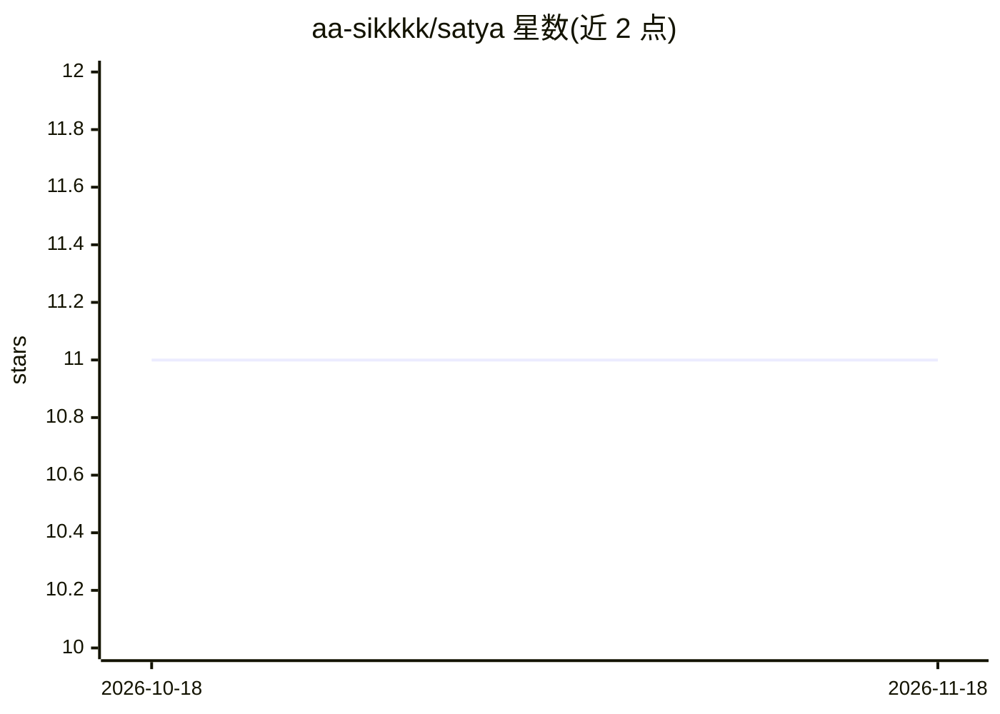

# aa-sikkkk/satya

⭐ 11 · Python · NOASSERTION · 推送 2026-11-09 · [GitHub](https://github.com/aa-sikkkk/satya) · 个人维护

**面向尼泊尔农村学生的离线本地 RAG 学习辅导平台**

本地优先的教育平台，面向尼泊尔 8-12 年级学生与教师，整合 RAG 与 Microsoft Phi 1.5 模型，离线与在线环境行为一致。机制：PDF/扫描件/手写笔记经统一脚本摄取，Tesseract/EasyOCR 做识别，512 token 分块后存入 ChromaDB，查询时经 sentence-transformers 嵌入检索并流式生成 3-4 句解释，低置信度输出带警告；另支持 ASCII 图示生成。许可为 PolyForm Noncommercial 1.0.0。Windows 提供离线安装包，pip 与源码安装亦可用。

## 筛选速览

| 维度 | 判定 | 备注 |
|---|---|---|
| AI 角色 | `ai-native` | 本体是模型或模型工具 |
| 许可风险 | `none` | NOASSERTION |
| 部署形态 | `library` | 以包/库形式分发 |
| 模型依赖 | local-ok | 支持本地模型 |
| 硬件要求 | `cpu-ok` | |
| 安装摩擦 | `low` | 无编译、无系统依赖或容器化 |
| 成熟度 | — | 结构信号不足 |

## 能力要点

- ChromaDB 向量检索同时搜索教材与教师笔记两个集合
- Phi 1.5 GGUF Q4_K_M 量化模型，4GB RAM 纯 CPU 运行
- 统一摄取脚本处理 PDF/扫描件/手写笔记，自动检测类型并分级分科
- 提供 CLI 与 CustomTkinter GUI 两种界面及学习进度导出导入

## 适用场景

- 无网络环境下让学生本地提问并获取基于教材的解释
- 教师批量摄取本地课程资料建立知识库
- 在老旧低配硬件上运行 AI 辅导系统

## 场景标签

`RAG` `文档问答` `知识库管理` · 领域:知识与检索

## 证据(README 行号)

> L16: Satya is a local-first learning platform optimized for the Nepali educational context. It provides content indexing
> L55: **3. Intelligent RAG System**
> L124: - **Response Generation** - Produces concise 3-4 sentence explanations (100-150 tokens)

## 星数曲线

2026-10-18 11 → 2026-11-18 11（+0）

---
*卡片 v1 · prompt 1.4 · 生成 2026-11-18 · 置信度 high · 依据 README sha `90d18d4996f6` · [字段定义](../../DATASET.md)*
