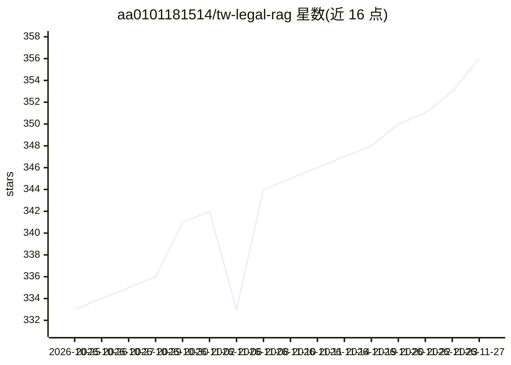

# aa0101181514/tw-legal-rag

⭐ 356 · Python · NOASSERTION · 推送 2026-11-22 · [GitHub](https://github.com/aa0101181514/tw-legal-rag) · [官网](https://dr-legal.com.tw) · 个人维护 · 中文 README

**给 AI 工具接入台湾法律检索的 MCP 服务器与 CLI**

提供 MCP 端点与命令行工具（twlegalrag），连接法律侦探的台湾法律语义检索服务：2,285 万笔裁判书、现行法规条文、行政函释与劳动裁决，支持自然语言检索、案号精确调卷、审级关联与全文调阅。检索结果打包为附引用白名单与验证指示的 bundle，供用户自己的 AI 工具使用；CLI 本身不调用 LLM、不生成法律意见。免费使用，连接需登录帐号，REST 自 2026-10-30 起需带凭据。

## 筛选速览

| 维度 | 判定 | 备注 |
|---|---|---|
| AI 角色 | `ai-ecosystem` | LLM/agent 周边工具 |
| 许可风险 | `none` | NOASSERTION |
| 部署形态 | `library` | 以包/库形式分发 |
| 模型依赖 | — | README 未给出锁定关系 |
| 硬件要求 | — | 无带数字的原话,不猜 |
| 安装摩擦 | `low` | 无编译、无系统依赖或容器化 |
| 成熟度 | — | 结构信号不足 |

## 能力要点

- 六个 MCP 工具：裁判检索、全文调阅、引用白名单 bundle、法条查询、函释查询与函释语义检索
- 引用防护：allowed_citations 白名单、unread_candidates 标记与 CLI 端 citation check
- 审级关联 case_history 含「废弃/驳回」旗标，引用前可见判决是否已被上级审废弃
- CLI 零 LLM 依赖，仅依赖 httpx/typer/rich

## 适用场景

- 让 Claude/ChatGPT 等助手直接语义检索台湾判决与法条
- 法律研究时核验 AI 引用的判决字号是否真实存在
- 查询行政函释效力状态，引用前确认是否已废止

## 场景标签

`语义搜索` `科研工具` · 领域:知识与检索

## 证据(README 行号)

> L40: 提供六個工具：裁判檢索、裁判全文與審級關聯、附引用白名單的 bundle、現行法條查詢、行政函釋字號查詢、行政函釋語義檢索。
> L45: does **not** generate legal advice, does **not** call any LLM, and does **not**
> L356: 搜尋透過 **Remote MCP** 直接接進你的 AI 工具。兩者填同一個 MCP 端點

## 星数曲线

2026-10-25 333 → 2026-11-27 356（+23）

---
*卡片 v1 · prompt 1.4 · 生成 2026-11-25 · 置信度 high · 依据 README sha `ead066f9294b` · [字段定义](../../DATASET.md)*
