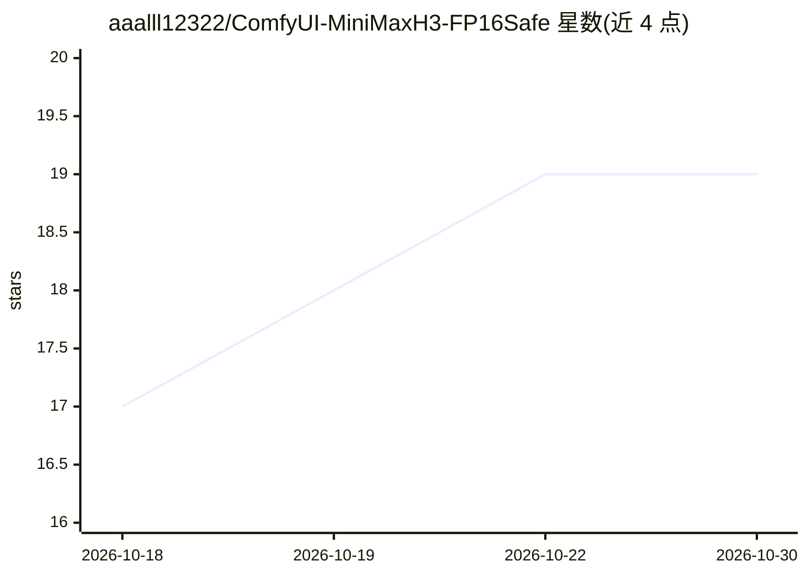

# aaalll12322/ComfyUI-MiniMaxH3-FP16Safe

⭐ 19 · Python · MIT · 推送 2026-08-22 · [GitHub](https://github.com/aaalll12322/ComfyUI-MiniMaxH3-FP16Safe) · 个人维护 · 中文 README

**让 MiniMax H3 在无 bf16 硬件（如 V100）上以 fp16 稳定运行的 ComfyUI 节点**

ComfyUI 自定义节点，针对 MiniMax H3 音视频 DiT 官方不支持 fp16 的限制：在 fp16 计算下将易溢出算子（残差流、RMSNorm、MLP gated-silu 等）升 fp32 或用 2 的幂固定缩放补偿，其余矩阵乘保持 fp16 Tensor Core，并带 isfinite 保险丝机制在溢出时用 fp32 重算。面向在 V100（sm_70）等无 bf16/fp8 硬件上跑 MiniMax H3 文生视频/参考图生视频的用户。安装方式为 git clone 到 custom_nodes，需 ComfyUI 含 PR #15224，不修改 ComfyUI 核心文件。

## 筛选速览

| 维度 | 判定 | 备注 |
|---|---|---|
| AI 角色 | `ai-ecosystem` | LLM/agent 周边工具 |
| 许可风险 | `permissive` | MIT |
| 部署形态 | `None` |  |
| 模型依赖 | — | README 未给出锁定关系 |
| 硬件要求 | — | 无带数字的原话,不猜 |
| 安装摩擦 | `low` | 无编译、无系统依赖或容器化 |
| 成熟度 | `idea` | |

## 能力要点

- fp16 计算下对溢出算子做 fp32 升级或 2 的幂固定缩放
- 残差流全程 fp32、attention/MLP 保持 fp16，零逐块 GPU 同步
- isfinite 保险丝：罕见溢出自动 fp32 重算
- 提供 debug_nan / profile 调试开关与 ref2va 示例工作流

## 适用场景

- 在 V100 等无 bf16 硬件上以接近 fp16 速度运行 MiniMax H3
- 解决强制 fp16 计算导致采样 NaN/黑图的问题
- 通过 profile 定位采样速度瓶颈

## 场景标签

`视频生成` `推理引擎` · 领域:内容生成

## 证据(README 行号)

> L9: 在 **V100（sm_70，无 bf16/fp8 硬件）** 或任何强制 fp16 计算的机器上，让 MiniMax H3（`comfy/ldm/minimax`，PR #15224）以**接近纯 fp16 的速度**获得**接近
> L15: 强行用"模型计算Dtype"节点设 fp16 计算 → 采样 NaN → 黑图。本插件在 fp16 计算下，把**会溢出的算子自动升 fp32 或用 2 的幂缩放补偿**，其余大矩阵乘保持 fp16（Tensor Core）。
> L140: - **ComfyUI**：需包含 PR #15224（`comfy/ldm/minimax/` 模块）。

## 星数曲线

2026-10-18 17 → 2026-10-30 19（+2）

---
*卡片 v1 · prompt 1.4 · 生成 2026-10-29 · 置信度 high · 依据 README sha `5e4356ada22b` · [字段定义](../../DATASET.md)*
