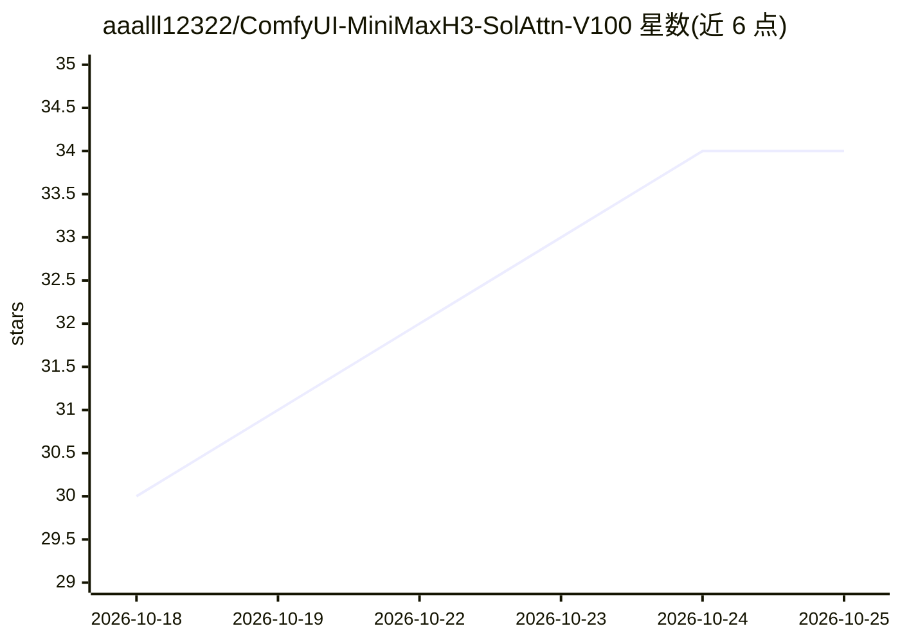

# aaalll12322/ComfyUI-MiniMaxH3-SolAttn-V100

⭐ 34 · C++ · NOASSERTION · 推送 2026-08-29 · [GitHub](https://github.com/aaalll12322/ComfyUI-MiniMaxH3-SolAttn-V100) · 个人维护 · 中文 README

**MiniMax H3 在 V100 上的注意力稀疏加速 ComfyUI 插件**

面向 ComfyUI 用户的自定义节点插件，包含两个互斥节点：Sol-Attn 阈值路由稀疏（keep-or-drop，无需训练）与 SLA Top-K 块稀疏（需配合 lightx2v SLA LoRA）。内嵌 FP16Safe 逻辑（prescale /16 + 熔断 + fp32 重跑）解决 V100 无 bf16 下的 NaN 问题，核心 kernel 随仓库分发源码，Windows 可用 Release 预编译 pyd。实测 480p/10s 从 71-74s/步 降至 43s/步。仅验证 V100(sm_70)+Windows+Python 3.12；README 声明自 2026-09-01 起因作者离开 GPU 环境暂停维护，期间不处理 Issue/PR。

## 筛选速览

| 维度 | 判定 | 备注 |
|---|---|---|
| AI 角色 | `ai-ecosystem` | LLM/agent 周边工具 |
| 许可风险 | `none` | NOASSERTION |
| 部署形态 | `None` |  |
| 模型依赖 | — | README 未给出锁定关系 |
| 硬件要求 | — | 无带数字的原话,不猜 |
| 安装摩擦 | `high` | 编译与系统依赖俱全 |
| 成熟度 | — | 结构信号不足 |

## 能力要点

- 双节点：Sol-Attn 阈值路由稀疏与 SLA Top-K 块稀疏（85% 稀疏对齐 lightx2v 官方蒸馏值）
- 内嵌 FP16Safe（prescale /16 + 熔断 + fp32 兜底），无需单独安装 FP16Safe 插件
- 音频段自动保底，避免稀疏导致的音频退化
- kernel 源码随仓库分发（native/），Windows 提供 Release 预编译 pyd

## 适用场景

- 在 V100 上加速 MiniMax H3 视频生成，绕开 fp32 回落的慢速路径
- 配合 lightx2v Minimax-h3-Turbo-SLA LoRA 走低密度稀疏推理
- 在 ComfyUI 工作流中以单节点同时获得 fp16 安全与稀疏加速

## 场景标签

`视频生成` · 领域:内容生成

## 证据(README 行号)

> L3: **MiniMax H3 在 V100 上的注意力稀疏加速插件（ComfyUI 自定义节点）· v1.2.0（双节点：Sol-Attn + SLA Top-K）**
> L20: 插件包含两个独立节点（同一 MODEL 上互斥使用，只挂一个）：
> L100: - **ComfyUI**（含 `comfy/ldm/minimax`，PR #15224）

## 星数曲线

2026-10-18 30 → 2026-10-25 34（+4）

---
*卡片 v1 · prompt 1.4 · 生成 2026-10-25 · 置信度 high · 依据 README sha `ad5716138857` · [字段定义](../../DATASET.md)*
