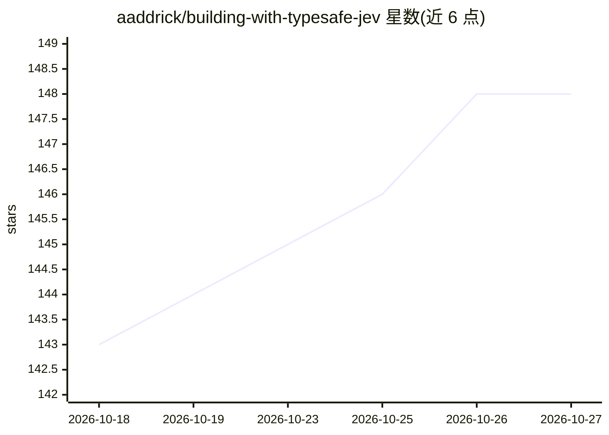

# aaddrick/building-with-typesafe-jev

⭐ 148 · Python · MIT · 推送 2026-10-01 · [GitHub](https://github.com/aaddrick/building-with-typesafe-jev) · [官网](https://github.com/aaddrick/building-with-typesafe-jev#readme) · 个人维护 · 中文 README

**教编码代理使用 Jev 类型化决策模型的社区技能**

非官方社区 agent 技能（SKILL.md 格式），面向 Claude Code、Codex、Antigravity CLI、Muse 等编码代理：教代理如何为 TypeSafe Jev 设计代码。Jev 是不生成文本的 System One 模型，接收内容与一组类型化问题，返回值与校准概率（Choice/Score/Noul 三种原语），通常 100-200 ms 内响应。技能内容分四层加载：选型规则、API 参考（HTTP/Python/JS SDK）、4 种官方模式与 18 本 cookbook 技法、150+ 社区项目按形态分类的索引。API key 为可选配置，用于调用前校验设计。附六任务 × 十次运行的隔离容器评测报告，与官方技能及无技能对照。

## 筛选速览

| 维度 | 判定 | 备注 |
|---|---|---|
| AI 角色 | `ai-knowledge` | 知识聚合/清单类 |
| 许可风险 | `permissive` | MIT |
| 部署形态 | `None` |  |
| 模型依赖 | — | README 未给出锁定关系 |
| 硬件要求 | — | 无带数字的原话,不猜 |
| 安装摩擦 | `low` | 无编译、无系统依赖或容器化 |
| 成熟度 | — | 结构信号不足 |

## 能力要点

- 类型化问题三原语：Choice（选项选择）、Score（量表评分）、Noul（命题概率）
- 按任务分层加载的四层内容（选型规则/API 参考/模式库/先例索引）
- 150+ 社区项目按工作形态分类，每类附代码示意
- 六任务隔离容器评测：三次 LLM 裁判多数决，平均通过率 0.96 ± 0.02（无技能 0.65）

## 适用场景

- 让我的编码代理正确设计调用 Jev API 的代码
- 在构建工作流前查阅既有模式与社区项目先例
- 配置 API key 让代理在写码前用线上 API 校验设计

## 场景标签

`提示工程` · 领域:Agent 开发

## 证据(README 行号)

> L21: Coding agents treat Jev like one more chat model. This skill teaches them to design for it: typed questions, calibr
> L23: Jev is a System One model. It does not write text. You send it content and a set of typed questions, and it answers
> L296: ## What is inside

## 星数曲线

2026-10-18 143 → 2026-10-27 148（+5）

---
*卡片 v1 · prompt 1.4 · 生成 2026-10-22 · 置信度 high · 依据 README sha `94ca0123d5c2` · [字段定义](../../DATASET.md)*
