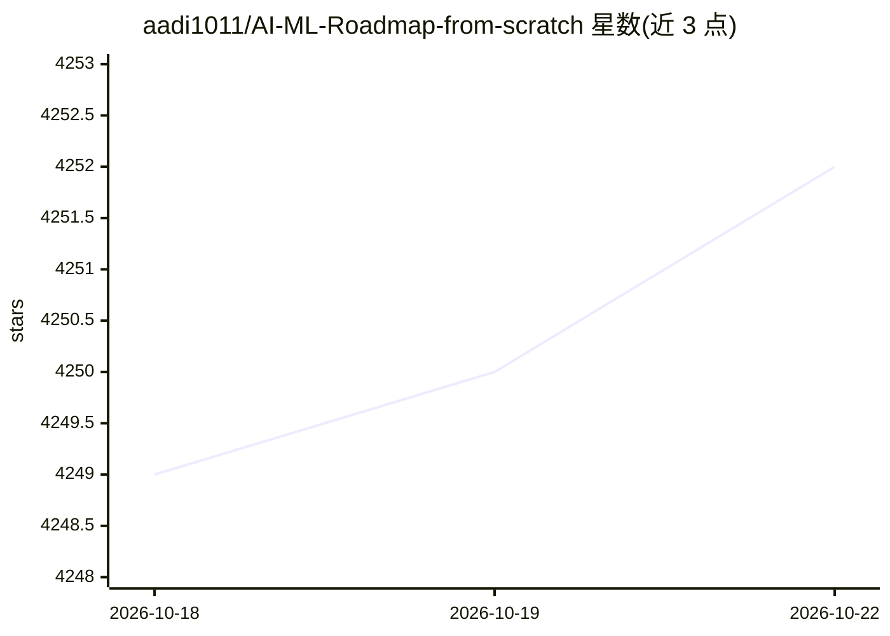

# aadi1011/AI-ML-Roadmap-from-scratch

⭐ 4,261 · MIT · 推送 2026-08-12 · [GitHub](https://github.com/aadi1011/AI-ML-Roadmap-from-scratch) · [官网](https://aadi1011.github.io/AI-ML-Roadmap-from-scratch/) · 个人维护

**AI/ML 从零到进阶的免费学习资源路线图清单**

面向自学者的 AI 与机器学习学习路线图仓库：按难度递增组织 11 个模块，从数学基础、Python 编程、数据科学，到机器学习、计算机视觉、深度学习、生成式 AI（含 RAG 子模块）、NLP、强化学习与 Agentic AI。每模块以表格列出来自 YouTube、在线课程、博客的免费资源，星标为推荐内容，另有项目练习、进阶课程、AI 资讯与博客链接。仓库接受社区贡献，不提供可安装的软件。

## 筛选速览

| 维度 | 判定 | 备注 |
|---|---|---|
| AI 角色 | `ai-knowledge` | 知识聚合/清单类 |
| 许可风险 | `permissive` | MIT |
| 部署形态 | `None` |  |
| 模型依赖 | — | README 未给出锁定关系 |
| 硬件要求 | — | 无带数字的原话,不猜 |
| 安装摩擦 | `low` | 无编译、无系统依赖或容器化 |
| 成熟度 | — | 结构信号不足 |

## 能力要点

- 11 个按难度递增组织的学习模块，覆盖数学到 Agentic AI
- 资源均为免费的 YouTube 视频与在线课程
- 含 RAG 子模块与项目练习、进阶学习路径清单
- 提供配套 YouTube 视频讲解

## 适用场景

- 按路线图系统自学 AI/机器学习
- 查找某个子领域（如 RAG、强化学习）的免费课程
- 寻找入门 AI 项目与练习题

## 场景标签

`教程课程` · 领域:学习与行业

## 证据(README 行号)

> L3: 🧠 Become skilled in Artificial Intelligence, Machine Learning, Generative AI, Deep Learning, Data Science, Natural L
> L7: 📚 These are a collection of the best free resources from YouTube and online courses, as well as other popular blogs 
> L13: ## Contents

## 星数曲线

2026-10-18 4,249 → 2026-10-22 4,252（+3）

---
*卡片 v1 · prompt 1.4 · 生成 2026-10-20 · 置信度 high · 依据 README sha `049465fabda9` · [字段定义](../../DATASET.md)*
