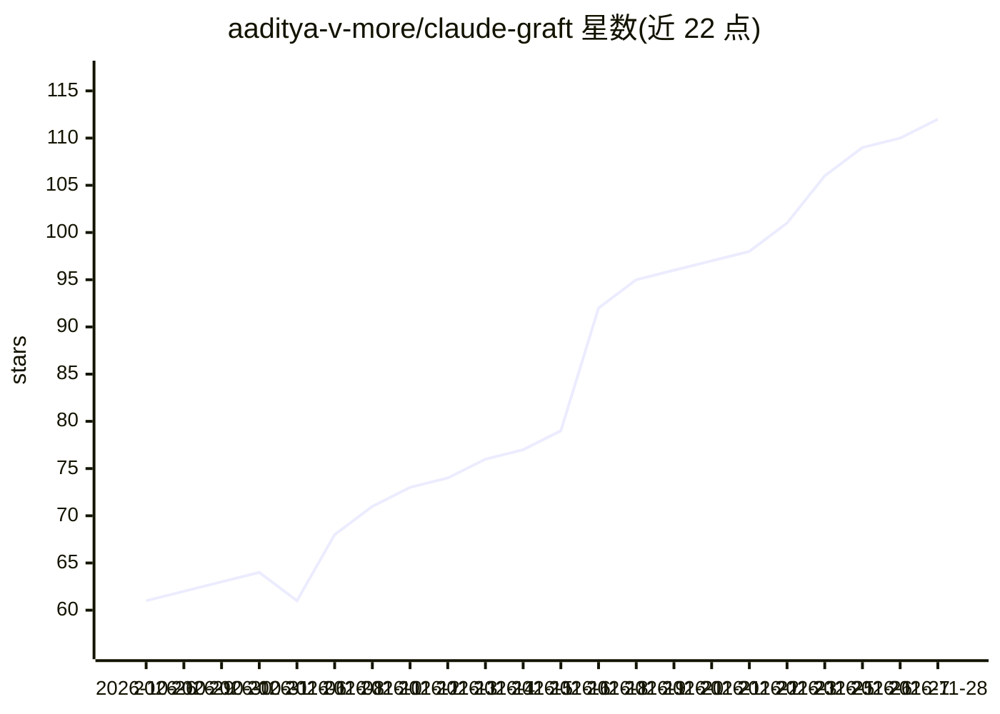

# aaditya-v-more/claude-graft

⭐ 112 · Swift · MIT · 推送 2026-11-27 · [GitHub](https://github.com/aaditya-v-more/claude-graft) · [官网](https://graft.aadityamore.com/) · 个人维护

**为 Mac/Windows 用户并行运行多个 Claude Desktop 账号并共享用量**

Claude Graft 是一款免费开源桌面工具，让多个 Claude 账号各自在独立的 Claude Desktop 实例中同时登录并行运行，切换账号无需登出。核心机制：各账号共享用量配额，当一个账号接近五小时或周限额时，Claude Code 通过本地运行的 relay 转用另一账号的额度继续工作；菜单栏/通知区展示各账号剩余用量。依赖已安装的 Claude Desktop，用量共享需 macOS 15；应用为 ad-hoc 签名，首开需在系统安全设置中放行。

## 筛选速览

| 维度 | 判定 | 备注 |
|---|---|---|
| AI 角色 | `ai-ecosystem` | LLM/agent 周边工具 |
| 许可风险 | `permissive` | MIT |
| 部署形态 | `desktop` | 安装包/桌面程序 |
| 模型依赖 | locked-api |  |
| 硬件要求 | — | 无带数字的原话,不猜 |
| 安装摩擦 | `low` | 无编译、无系统依赖或容器化 |
| 成熟度 | — | 结构信号不足 |

## 能力要点

- 多账号并行运行：每账号独立 Claude Desktop 实例，切换不登出
- 用量共享：配额接近上限时 Claude Code 自动转用其他账号额度
- Mac 菜单栏展示各账号五小时/周/模型用量与当前应答账号
- 附带系统级听写：按住右 Command 键在任意应用输入语音转写

## 适用场景

- 同时管理多个 Claude 账号并行工作
- 账号额度接近上限时让 Claude Code 无缝继续
- 跨账号集中查看 artifacts、projects 和聊天记录
- 在任意应用中用语音输入文字

## 场景标签

 · 领域:开发者工具/AI 客户端辅助

## 证据(README 行号)

> L25: One Claude login is never quite the right amount. Claude Graft runs all your
> L29: with another's. Graft lives in the Mac menu bar or the Windows notification area. It is free and open source.
> L70: Sharing sends that Claude's Claude Code through a small relay Graft runs. Before

## 星数曲线

2026-10-26 61 → 2026-11-28 112（+51）

---
*卡片 v1 · prompt 1.4 · 生成 2026-11-28 · 置信度 high · 依据 README sha `6c5aad09ec17` · [字段定义](../../DATASET.md)*
