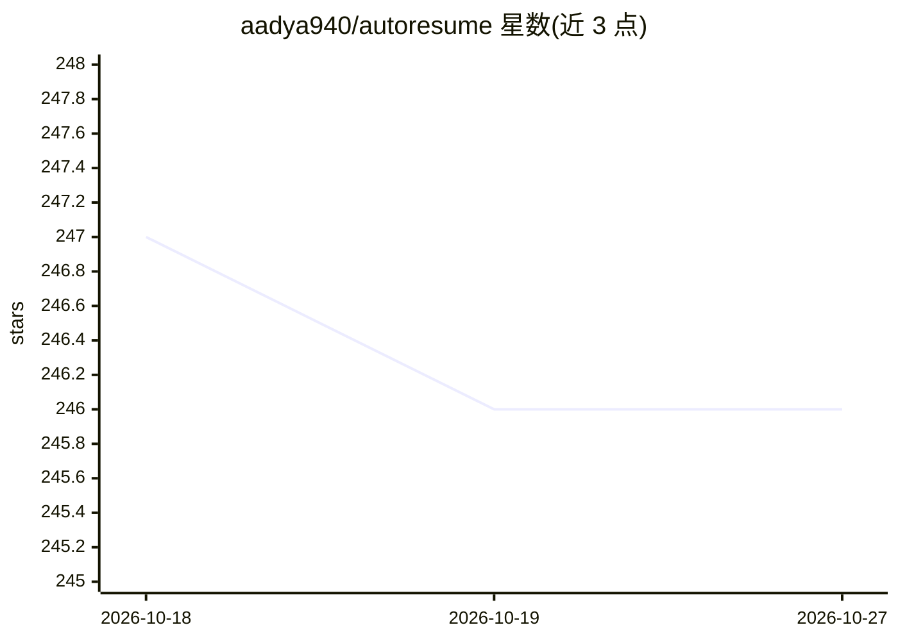

# aadya940/autoresume

⭐ 246 · JavaScript · Apache-2.0 · 推送 2026-01-09 · [GitHub](https://github.com/aadya940/autoresume) · 个人维护

**AI 简历撰写与求职匹配的开源 Web 应用**

面向求职者的全栈 Web 应用：基于 Google Gemini 生成遵循哈佛/哥伦比亚求职指南的简历与求职信，从职位描述中检测缺失的硬技能与关键词做 ATS 优化，并通过 JobSpy 自动匹配符合技能的职位。简历排版采用 LaTeX 生成 ATS 友好格式，提供实时预览与人工最终编辑控制。技术栈为 React + FastAPI + Docker，需用户自行提供 Gemini API key，通过 docker compose 一键启动。

## 筛选速览

| 维度 | 判定 | 备注 |
|---|---|---|
| AI 角色 | `ai-native` | 本体是模型或模型工具 |
| 许可风险 | `permissive` | Apache-2.0 |
| 部署形态 | `self-host` | docker 或自建部署 |
| 模型依赖 | — | README 未给出锁定关系 |
| 硬件要求 | — | 无带数字的原话,不猜 |
| 安装摩擦 | `low` | 无编译、无系统依赖或容器化 |
| 成熟度 | — | 结构信号不足 |

## 能力要点

- Gemini 生成简历与求职信，遵循哈佛/哥伦比亚职业指南
- 对照职位描述检测缺失硬技能与 ATS 关键词
- JobSpy 自动匹配符合技能经验的职位
- LaTeX 排版输出 ATS 友好布局，支持实时预览

## 适用场景

- 求职者用 AI 起草并优化简历与求职信
- 针对具体职位描述补充 ATS 关键词提升通过率
- 根据简历技能自动发现匹配的工作机会

## 场景标签

`AI 写作` · 领域:内容生成

## 证据(README 行号)

> L3: **Build professional resumes with AI and automatically find the jobs that match them.**
> L21: - AI-Backed, Professional Writing – Generates resumes and cover letters following Harvard & Columbia career guideli
> L32: - **AI**: Google Gemini

## 星数曲线

2026-10-18 247 → 2026-10-27 246（-1）

---
*卡片 v1 · prompt 1.4 · 生成 2026-10-22 · 置信度 high · 依据 README sha `849900a8d7eb` · [字段定义](../../DATASET.md)*
