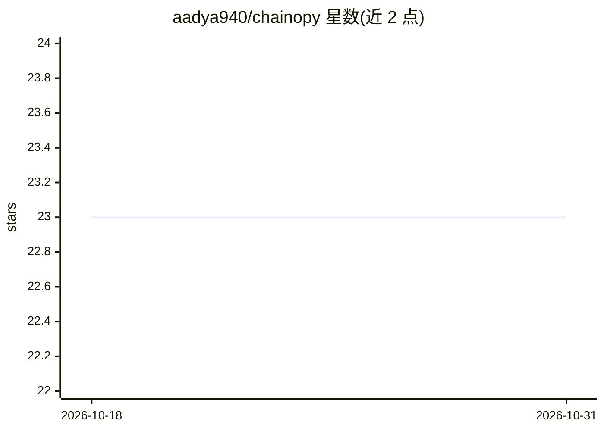

# aadya940/chainopy

⭐ 23 · Python · BSD-2-Clause · 推送 2026-09-09 · [GitHub](https://github.com/aadya940/chainopy) · [官网](https://chainopy.readthedocs.io/en/latest/) · 个人维护

**离散时间马尔可夫链随机分析的 Python 库**

提供马尔可夫链基础算法、马尔可夫链神经网络与马尔可夫切换模型三类功能的 Python 库：可创建状态转移矩阵定义的马尔可夫链、从马尔可夫链构建等价的神经网络（可指定层数），并对单变量时间序列构建多体制切换模型与预测（示例含股票周高数据预测）。支持 Numpy 2.0.0，模型保存采用内存高效方式。面向做随机过程分析与时间序列预测的开发者和科研用户，可通过 pip 或源码构建安装。

## 筛选速览

| 维度 | 判定 | 备注 |
|---|---|---|
| AI 角色 | `ai-native` | 本体是模型或模型工具 |
| 许可风险 | `permissive` | BSD-2-Clause |
| 部署形态 | `library` | 以包/库形式分发 |
| 模型依赖 | — | README 未给出锁定关系 |
| 硬件要求 | — | 无带数字的原话,不猜 |
| 安装摩擦 | `low` | 无编译、无系统依赖或容器化 |
| 成熟度 | — | 结构信号不足 |

## 能力要点

- 创建马尔可夫链与等价的马尔可夫链神经网络（可指定层数）
- 单变量时间序列的马尔可夫切换模型与多步预测
- 支持 Numpy 2.0.0，内存高效的模型保存

## 适用场景

- 用状态转移矩阵构建并分析离散马尔可夫链
- 对单变量时间序列做多体制切换建模并预测未来走势
- 从马尔可夫链构建等价神经网络进行模拟

## 场景标签

 · 领域:机器学习/统计分析

## 证据(README 行号)

> L4: A Python 🐍 Package for Markov Chains, Markov Chain Neural Networks and Markov Switching Models.
> L57: >>> neural_network = chainopy.MarkovChainNeuralNetwork(mc, num_layers = 5)    # Creates a 5-layered Neural Network 

## 星数曲线

2026-10-18 23 → 2026-10-31 23（+0）

---
*卡片 v1 · prompt 1.4 · 生成 2026-10-27 · 置信度 high · 依据 README sha `78fbb195c22c` · [字段定义](../../DATASET.md)*
