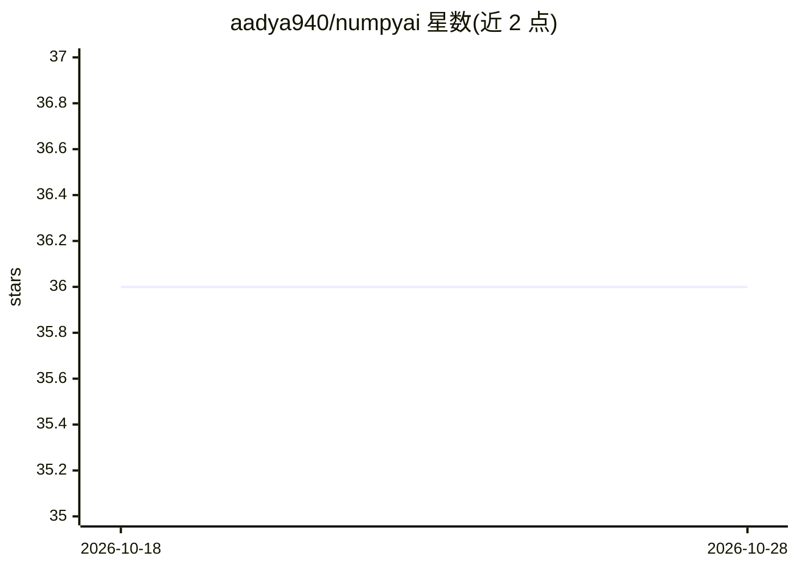

# aadya940/numpyai

⭐ 36 · Python · MIT · 推送 2026-08-15 · [GitHub](https://github.com/aadya940/numpyai) · [官网](https://numpyai.readthedocs.io/en/latest/) · 个人维护

**用自然语言操作 NumPy 数组的 Python 库（LLM 驱动）**

构建在 Pydantic AI 之上的 Python 库，让用户以英文提问，由 LLM 生成并在校验后执行 NumPy 代码，返回结果。支持多数组会话（NumpyAISession）、分析步骤建议（Diagnosis）、自动重试与详细模式。模型侧 provider 无关：可接入 Google Gemini、OpenAI、Anthropic、Groq、Mistral、Ollama 及 OpenAI 兼容端点，通过环境变量设置 API key，pip 安装并按 provider 分组可选依赖。

## 筛选速览

| 维度 | 判定 | 备注 |
|---|---|---|
| AI 角色 | `ai-native` | 本体是模型或模型工具 |
| 许可风险 | `permissive` | MIT |
| 部署形态 | `library` | 以包/库形式分发 |
| 模型依赖 | locked-api |  |
| 硬件要求 | — | 无带数字的原话,不猜 |
| 安装摩擦 | `low` | 无编译、无系统依赖或容器化 |
| 成熟度 | — | 结构信号不足 |

## 能力要点

- 自然语言生成并执行 NumPy 代码
- 生成代码先做语法检查与独立校验再返回
- 支持多数组会话与分析步骤建议（Diagnosis）
- 基于 Pydantic AI 的 provider 无关设计

## 适用场景

- 用英文提问直接完成数组分析，不用手写 NumPy 代码
- 在一个会话中对多个数组提问与对话
- 让 AI 建议针对当前数据的下一步分析步骤

## 场景标签

`数据分析` · 领域:效率与自动化

## 证据(README 行号)

> L7: NumpyAI lets you interact with NumPy arrays using plain English. It ships as a small,
> L9: you can plug in Google Gemini, OpenAI, Anthropic, or any other model Pydantic AI supports
> L16: - Ask questions in English; NumpyAI generates and executes NumPy code for you.

## 星数曲线

2026-10-18 36 → 2026-10-28 36（+0）

---
*卡片 v1 · prompt 1.4 · 生成 2026-10-25 · 置信度 high · 依据 README sha `6dec14acd0dc` · [字段定义](../../DATASET.md)*
