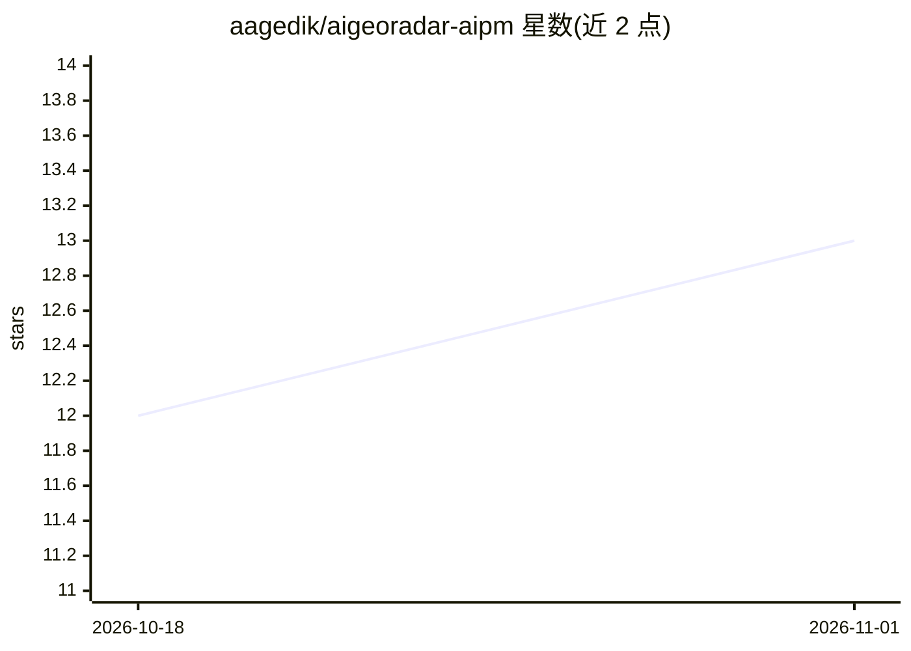

# aagedik/aigeoradar-aipm

⭐ 13 · NOASSERTION · 推送 2026-07-18 · [GitHub](https://github.com/aagedik/aigeoradar-aipm) · [官网](https://aigeoradar.com/specifications/aipm) · 个人维护

**开放规范：为每个网页定义 .ai.json 元数据供 AI 爬虫读取**

AI Page Manifest (AIPM) 是一个由 AigeoRadar 维护的开放规范（v1.2.0，RFC AIPM-002，状态 Stable，CC BY 4.0）：为每个页面定义旁挂的 `.ai.json` JSON 文件，包含 purpose、abstract、keyFacts、主题、语言等字段，供 AI 爬虫、RAG 系统和 GEO（生成式引擎优化）直接获取页面事实而无需解析 HTML。规范定位为 llms.txt（站点级）与 entity.json（品牌级）之外的页面级补充，提供 JSON Schema 校验、HTML link 发现机制，以及 Laravel CMS 与 WordPress 两种参考实现。采用方式为复制 schema 并在 CMS 中生成对应 JSON 文件，非安装型软件。

## 筛选速览

| 维度 | 判定 | 备注 |
|---|---|---|
| AI 角色 | `ai-ecosystem` | LLM/agent 周边工具 |
| 许可风险 | `none` | NOASSERTION |
| 部署形态 | `None` |  |
| 模型依赖 | — | README 未给出锁定关系 |
| 硬件要求 | — | 无带数字的原话,不猜 |
| 安装摩擦 | `low` | 无编译、无系统依赖或容器化 |
| 成熟度 | — | 结构信号不足 |

## 能力要点

- 页面级 `.ai.json` 旁挂文件规范，配套 JSON Schema 1.2 校验
- 与 llms.txt / entity.json / ai-feed.xml 构成 AI 发现读取顺序（ADF）
- 提供 Laravel CMS 与 WordPress（AigeoRadar Connector）参考实现
- HTML `<link rel=alternate>` 发现机制与迁移/最佳实践文档

## 适用场景

- 为站点页面发布机器可读元数据供 AI 爬虫抓取
- 在 RAG 管道中用结构化页面事实替代解析完整 HTML
- 配合 llms.txt 完善 AI 搜索/GEO 的内容发现

## 场景标签

 · 领域:Web 标准/AI 发现基础设施

## 证据(README 行号)

> L3: **Open specification for per-page `.ai.json` — machine-readable page metadata for AI crawlers, RAG systems, and GEO 
> L25: Crawlers and tools can fetch facts (`purpose`, `abstract`, `keyFacts`, topic, language) **without** parsing the ful
> L39: 1. `/llms.txt` — site guide

## 星数曲线

2026-10-18 12 → 2026-11-01 13（+1）

---
*卡片 v1 · prompt 1.4 · 生成 2026-10-31 · 置信度 high · 依据 README sha `880a466542bd` · [字段定义](../../DATASET.md)*
