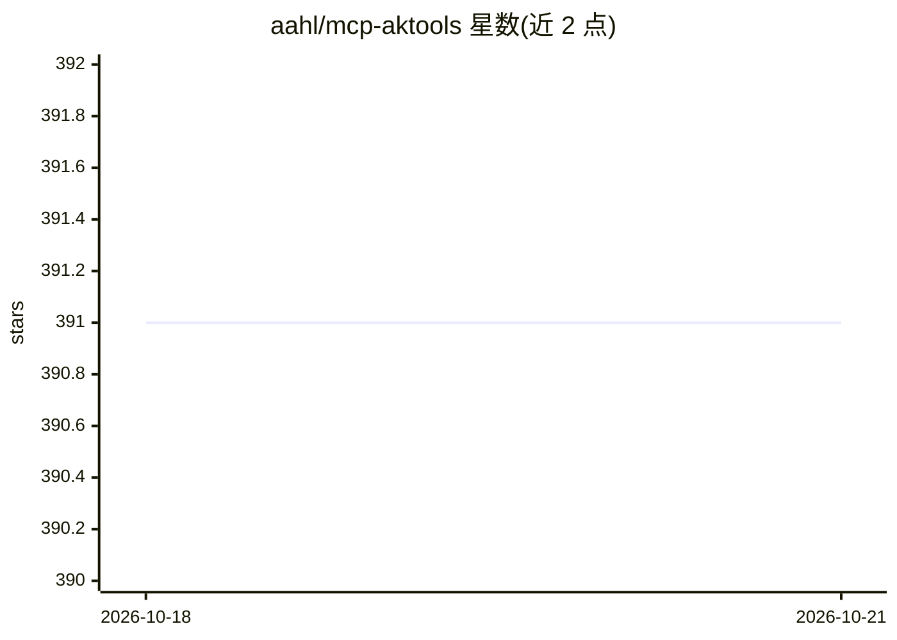

# aahl/mcp-aktools

⭐ 391 · Python · MIT · 推送 2026-03-26 · [GitHub](https://github.com/aahl/mcp-aktools) · 个人维护 · 中文 README

**基于 akshare 的股票与加密货币数据查询 MCP 服务器**

基于 akshare 的 MCP (Model Context Protocol) 服务器，向 LLM 客户端暴露约 17 个金融数据工具：股票搜索（A股/港股/美股）、个股信息与历史价格（含技术指标）、A股涨停池/龙虎榜/资金流向、财务指标、个股与全球财经新闻、加密货币行情（OKX 历史/杠杆多空比/主动买卖、Binance AI 报告），另含投资建议工具。安装支持 uvx、Smithery（需 OAuth 或 key）、Docker，可接入 Cursor、VS Code、Cherry Studio、Claude Code、OpenAI CodeX 等客户端。

## 筛选速览

| 维度 | 判定 | 备注 |
|---|---|---|
| AI 角色 | `ai-ecosystem` | LLM/agent 周边工具 |
| 许可风险 | `permissive` | MIT |
| 部署形态 | `self-host` | docker 或自建部署 |
| 模型依赖 | — | README 未给出锁定关系 |
| 硬件要求 | — | 无带数字的原话,不猜 |
| 安装摩擦 | `low` | 无编译、无系统依赖或容器化 |
| 成熟度 | — | 结构信号不足 |

## 能力要点

- 17 个工具覆盖个股、A股市场、财经资讯、加密货币四类
- 支持 A股/港股/美股搜索与财务指标查询
- 提供 OKX 与 Binance 加密货币数据及 AI 分析报告
- 支持 uvx、Smithery、Docker 三种安装方式

## 适用场景

- 在 Claude Code 或 Cursor 中直接查询股票行情与财务指标
- 让 AI 助手分析加密货币杠杆与买卖数据
- 获取 A 股涨停池、龙虎榜与资金流向等市场概况

## 场景标签

`金融量化` · 领域:学习与行业

## 证据(README 行号)

> L3: 基于 akshare 的 MCP (Model Context Protocol) 服务器，提供股票、加密货币的数据查询和分析功能。
> L54: - 添加到 Claude Code, 执行命令: `claude mcp add aktools -- uvx mcp-aktools`

## 星数曲线

2026-10-18 391 → 2026-10-21 391（+0）

---
*卡片 v1 · prompt 1.4 · 生成 2026-10-22 · 置信度 high · 依据 README sha `9bf635ccf76c` · [字段定义](../../DATASET.md)*
