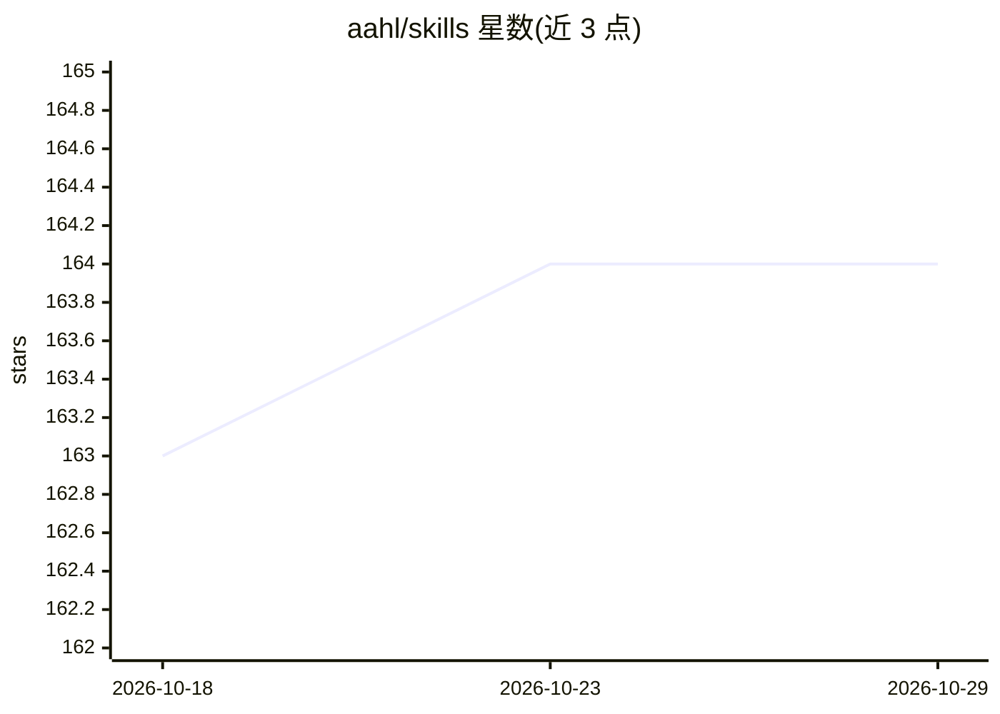

# aahl/skills

⭐ 164 · Python · MIT · 推送 2026-09-15 · [GitHub](https://github.com/aahl/skills) · [官网](https://skills.sh/aahl/skills) · 个人维护 · 中文 README

**个人智能体技能集合：智能家居、TTS、搜索、飞书等工具技能**

AAHL 维护的 agent 技能仓库，收录十余个 SKILL 类技能：通过 MCP 协议控制与查询 Home Assistant 智能家居、基于 Edge TTS 与智谱 GLM-TTS 的文本转语音、Qwen ASR 音频转写（无需 API key）、DuckDuckGo 搜索、DeepWiki 文档检索、飞书/Lark 开放平台管理、EdgeOne 页面部署、Google Trends、加密货币行情、中国天气与国家统计局数据查询、影视搜索与电商比价。技能通过 npx skills add 命令安装，面向 Claude 类 agent 框架使用。

## 筛选速览

| 维度 | 判定 | 备注 |
|---|---|---|
| AI 角色 | `ai-knowledge` | 知识聚合/清单类 |
| 许可风险 | `permissive` | MIT |
| 部署形态 | `library` | 以包/库形式分发 |
| 模型依赖 | — | README 未给出锁定关系 |
| 硬件要求 | — | 无带数字的原话,不猜 |
| 安装摩擦 | `low` | 无编译、无系统依赖或容器化 |
| 成熟度 | — | 结构信号不足 |

## 能力要点

- 十余个技能覆盖智能家居控制、TTS/ASR、搜索、飞书、数据查询等
- Qwen ASR 与 EdgeOne 部署无需配置或 API key
- npx skills add aahl/skills 一条命令安装

## 适用场景

- 为 Claude 类 agent 增加智能家居与飞书办公能力
- 让 agent 具备语音合成与音频转写能力
- 查询天气、统计数据、影视与电商比价信息

## 场景标签

`语音合成` `语音识别` · 领域:内容生成

## 证据(README 行号)

> L3: ## 📥 Install Skills
> L9: ## 🏠 Home Assistant (mcp-hass) Require
> L15: ## 🗣️ Edge TTS (edge-tts) Require

## 星数曲线

2026-10-18 163 → 2026-10-29 164（+1）

---
*卡片 v1 · prompt 1.4 · 生成 2026-10-23 · 置信度 high · 依据 README sha `b5b347ec1105` · [字段定义](../../DATASET.md)*
