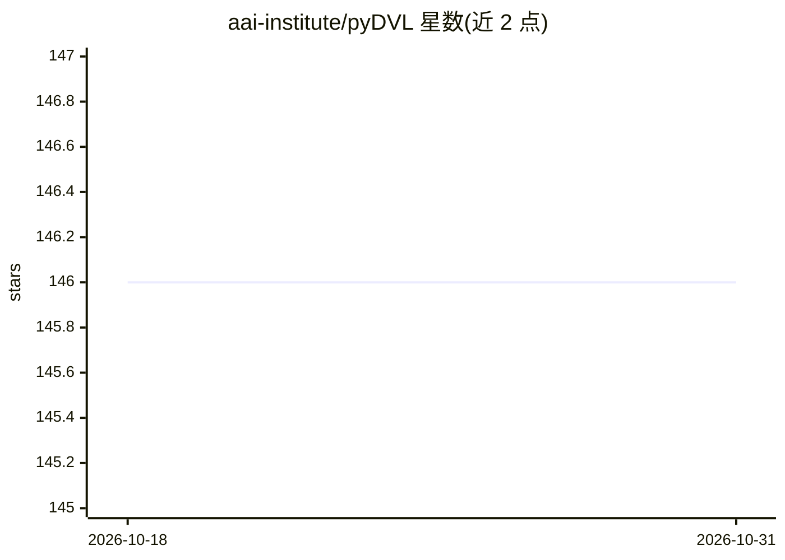

# aai-institute/pyDVL

⭐ 146 · Python · LGPL-3.0 · 推送 2026-04-13 · [GitHub](https://github.com/aai-institute/pyDVL) · [官网](https://pydvl.org) · 组织维护

**为机器学习做数据估值与影响函数计算的 Python 库**

pyDVL 收集数据估值与影响函数算法的稳定实现：数据估值为训练集中每个样本赋予反映其对模型性能贡献的标量值（Shapley 值、Banzhaf 等，含 Monte Carlo 近似方法），影响函数度量训练点对模型参数或单个测试点的影响，支持分块与核外计算以处理较大数据集。面向 ML 开发者与研究人员，通过 pip 安装；影响函数目前仅支持 PyTorch，计划支持 JAX；估值接口从 pydvl.value 迁移至 pydvl.valuation，旧模块已声明弃用。

## 筛选速览

| 维度 | 判定 | 备注 |
|---|---|---|
| AI 角色 | `ai-ecosystem` | LLM/agent 周边工具 |
| 许可风险 | `viral` | LGPL-3.0 |
| 部署形态 | `library` | 以包/库形式分发 |
| 模型依赖 | — | README 未给出锁定关系 |
| 硬件要求 | — | 无带数字的原话,不猜 |
| 安装摩擦 | `low` | 无编译、无系统依赖或容器化 |
| 成熟度 | — | 结构信号不足 |

## 能力要点

- 数据估值：为每个训练样本计算对模型性能的贡献值
- 影响函数：度量训练样本对模型参数与测试点的影响，支持分块与核外计算
- 估值结果 ValuationResult 可切片、排序并转换为 dataframe
- 提供 pyDVL[influence] 等额外依赖安装项

## 适用场景

- 识别低价值或错标、分布外的训练样本以清洗数据
- 分析训练样本对模型在特定测试点上是有益还是有害
- 比较不同数据估值方法在样本移除任务上的表现

## 场景标签

 · 领域:机器学习/数据工具库

## 证据(README 行号)

> L13: **pyDVL** collects algorithms for **Data Valuation** and **Influence Function**
> L16: **Data Valuation** for machine learning is the task of assigning a scalar
> L33: The **Influence Function** is an infinitesimal measure of the effect that single

## 星数曲线

2026-10-18 146 → 2026-10-31 146（+0）

---
*卡片 v1 · prompt 1.4 · 生成 2026-10-22 · 置信度 high · 依据 README sha `4dcb1829fa23` · [字段定义](../../DATASET.md)*
