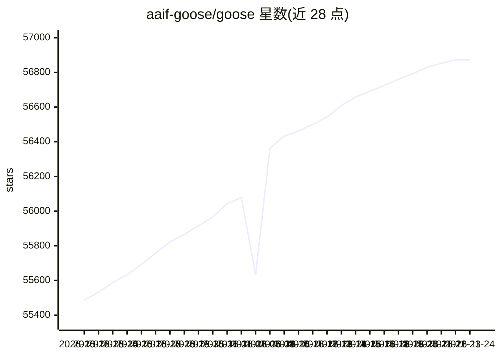

# aaif-goose/goose

⭐ 56,904 · Rust · Apache-2.0 · 推送 2026-11-24 · [GitHub](https://github.com/aaif-goose/goose) · [官网](https://goose-docs.ai/) · 组织维护

**可扩展的通用 AI agent：桌面/CLI 安装、执行、编辑与测试**

goose 是一个用 oi-kit 构建的通用 agent，覆盖编码、研究、写作、自动化与数据分析，提供 macOS/Linux/Windows 桌面应用与 CLI 两种形态，通过 MCP 连接工具与数据。支持直接进程内加载本地模型，或连接超过 85 家模型服务商。第三方应用可通过 ACP 协议将 goose 二进制作为 agent 后端以子进程方式运行。仓库同时提供 oi-kit 的 Rust 组件库及 Python/Kotlin 绑定，oi-kit 目前处于 alpha 阶段。goose 隶属 Linux 基金会旗下的 Agentic AI Foundation。

## 筛选速览

| 维度 | 判定 | 备注 |
|---|---|---|
| AI 角色 | `ai-native` | 本体是模型或模型工具 |
| 许可风险 | `permissive` | Apache-2.0 |
| 部署形态 | `None` |  |
| 模型依赖 | locked-api |  |
| 硬件要求 | — | 无带数字的原话,不猜 |
| 安装摩擦 | `low` | 无编译、无系统依赖或容器化 |
| 成熟度 | `idea` | |

## 动量与使用信号

- 维护:`active` — 距上次 push 0.7 天,年发版 71,453 位贡献者
- 涨星:近 1 天 **+31**(自 20261016 起算)
- 下载:GitHub Release 附件 累计 1,913,624(100 个 release)
- 平台:WINDOWS / MACOS / LINUX · 协议:MCP / OLLAMA

## 能力要点

- 桌面应用与 CLI 双形态，支持 macOS/Linux/Windows
- 支持进程内加载本地模型，无需独立推理服务器
- 可连接超过 85 家模型服务商（含 Anthropic、OpenAI、Gemini 等）
- 通过 ACP 协议作为其他应用的 agent 后端

## 适用场景

- 在终端或桌面端让 agent 自动执行编码、测试任务
- 通过 MCP 为 agent 接入自定义工具与数据源
- 将 goose 作为自有应用的 agent 后端
- 用 oi-kit 组件构建自己的 agent 应用

## 场景标签

`编码 Agent` `AI 助手` `数据分析` · 领域:效率与自动化

## 证据(README 行号)

> L16: oi-kit provides the reusable Rust components for building agents. goose is a complete agent built with oi-kit: use 
> L38: goose is a general-purpose agent for coding, research, writing, automation, and data analysis. Use the native deskt

## 星数曲线

2026-10-22 55,487 → 2026-11-24 56,872（+1,385）

---
*卡片 v1 · prompt 1.4 · 生成 2026-11-22 · 置信度 high · 依据 README sha `7591c76d3eb7` · [字段定义](../../DATASET.md)*
