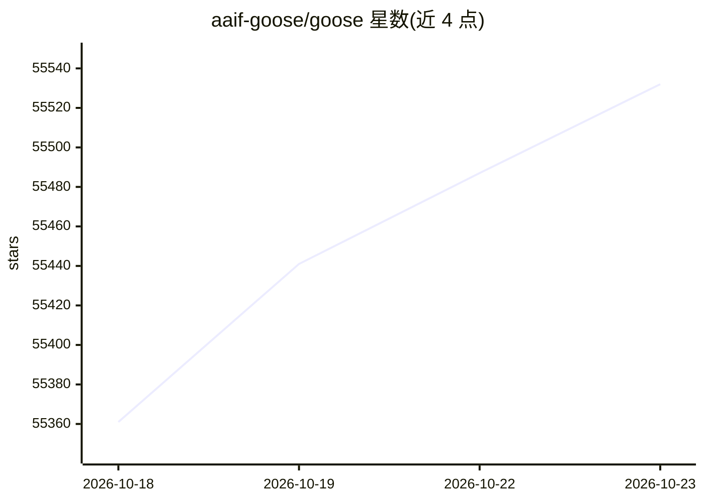

# aaif-goose/goose

⭐ 55,532 · Rust · Apache-2.0 · 推送 2026-10-22 · [GitHub](https://github.com/aaif-goose/goose) · [官网](https://goose-docs.ai/) · 组织维护

**本地运行的通用开源 AI agent：桌面应用、CLI 与 API 三形态**

goose 是运行在用户本机的通用 AI agent，用途不限于代码，也覆盖研究、写作、自动化与数据分析。提供 macOS/Linux/Windows 桌面应用、完整 CLI 与嵌入用 API，以 Rust 构建并开源（Apache-2.0）。接入 15+ 模型提供商，支持 API key 或经 ACP 使用已有的 Claude/ChatGPT/Gemini 订阅；通过 MCP 开放标准连接 70+ 扩展，并支持自定义发行版（预配置 provider、扩展与品牌）。项目隶属 Linux Foundation 下的 Agentic AI Foundation。

## 筛选速览

| 维度 | 判定 | 备注 |
|---|---|---|
| AI 角色 | `ai-native` | 本体是模型或模型工具 |
| 许可风险 | `permissive` | Apache-2.0 |
| 部署形态 | `None` |  |
| 模型依赖 | — | README 未给出锁定关系 |
| 硬件要求 | — | 无带数字的原话,不猜 |
| 安装摩擦 | `low` | 无编译、无系统依赖或容器化 |
| 成熟度 | — | 结构信号不足 |

## 动量与使用信号

- 维护:`active` — 距上次 push 0.7 天,年发版 71,453 位贡献者
- 涨星:近 1 天 **+31**(自 20261016 起算)
- 下载:GitHub Release 附件 累计 1,913,624(100 个 release)
- 平台:WINDOWS / MACOS / LINUX · 协议:MCP / OLLAMA

## 能力要点

- 桌面应用、CLI、API 三种交付形态，Rust 构建
- 支持 15+ 模型提供商，可经 ACP 复用已有订阅
- 通过 MCP 标准连接 70+ 扩展
- 支持构建自定义发行版（Custom Distributions）

## 适用场景

- 在本地终端用自然语言执行安装、编辑、测试等开发任务
- 接入自有模型 API key 做自动化工作流
- 用桌面应用进行研究、写作、数据分析等日常任务

## 场景标签

`AI 助手` `编码 Agent` · 领域:编码与开发

## 证据(README 行号)

> L16: goose is a general-purpose AI agent that runs on your machine. Not just for code — use it for research, writing, au
> L20: goose works with 15+ providers — Anthropic, OpenAI, Google, Ollama, OpenRouter, Azure, Bedrock, and more. Use API k
> L18: A native desktop app for macOS, Linux, and Windows. A full CLI for terminal workflows. An API to embed it anywhere.

## 星数曲线

2026-10-18 55,361 → 2026-10-23 55,532（+171）

---
*卡片 v1 · prompt 1.4 · 生成 2026-10-18 · 置信度 high · 依据 README sha `6b7d0e19fd92` · [字段定义](../../DATASET.md)*
