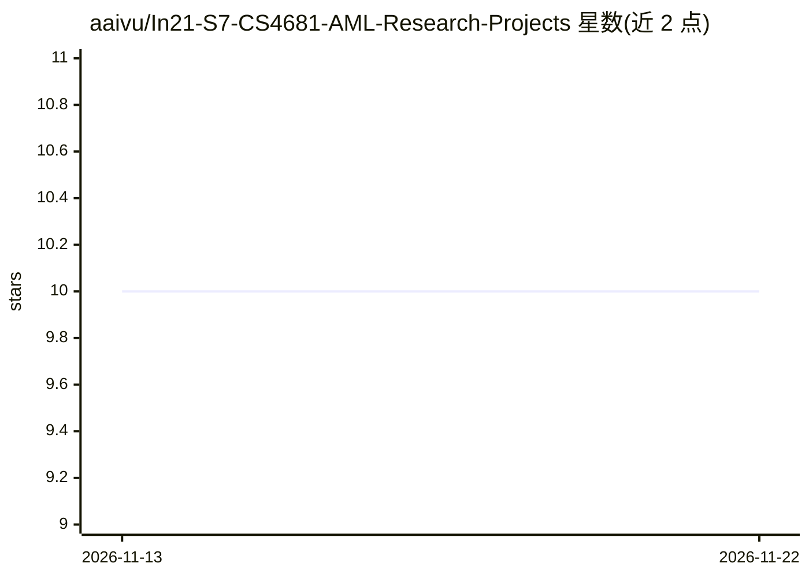

# aaivu/In21-S7-CS4681-AML-Research-Projects

⭐ 10 · Jupyter Notebook · MIT · 推送 2026-11-13 · [GitHub](https://github.com/aaivu/In21-S7-CS4681-AML-Research-Projects) · 组织维护

**莫拉图瓦大学机器学习课程的学生研究项目集合**

斯里兰卡莫拉图瓦大学 CS4681 高级机器学习课程（In21 级、第 7 学期）的学生研究项目组织仓库，由计算机科学与工程系管理。README 按计算机视觉、NLP、网络安全 AI、医疗 AI、图网络、航天 AI 等研究领域汇总项目，提供项目目录结构、学生资源门户（项目指南、研究提案模板、GitHub Issues 进度跟踪）、导师仪表盘与周会机制，以及文档/模板/论坛等资源中心。

## 筛选速览

| 维度 | 判定 | 备注 |
|---|---|---|
| AI 角色 | `ai-knowledge` | 知识聚合/清单类 |
| 许可风险 | `permissive` | MIT |
| 部署形态 | `None` |  |
| 模型依赖 | — | README 未给出锁定关系 |
| 硬件要求 | — | 无带数字的原话,不猜 |
| 安装摩擦 | `low` | 无编译、无系统依赖或容器化 |
| 成熟度 | — | 结构信号不足 |

## 能力要点

- 按 NLP、CV、医疗、安全、图网络等领域组织的学生项目集合
- 学生门户与导师仪表盘，基于 GitHub Issues 跟踪进度
- 提供项目指南与研究提案模板等标准化文档
- 16 周研究阶段时间线（文献综述→实现→实验→答辩）

## 适用场景

- 了解该课程学生机器学习研究项目的领域分布
- 课程教学中参考项目组织与进度管理方式

## 场景标签

`教程课程` · 领域:学习与行业

## 证据(README 行号)

> L1: ## 🎓 Advanced Machine Learning Research Projects
> L103: 🚀 **Navigate:** projects/[YOUR-INDEX]-[YOUR-AREA]/
> L218:  🏛️ Managed by the Department of Computer Science & Engineering

## 星数曲线

2026-11-13 10 → 2026-11-22 10（+0）

---
*卡片 v1 · prompt 1.4 · 生成 2026-11-20 · 置信度 high · 依据 README sha `d251af605e07` · [字段定义](../../DATASET.md)*
