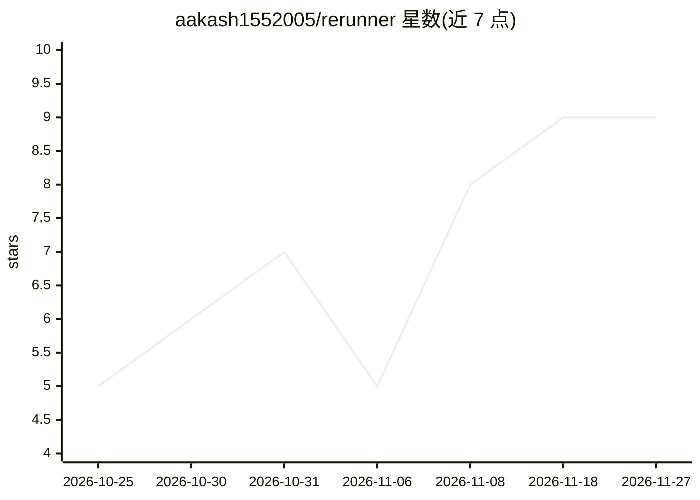

# aakash1552005/rerunner

⭐ 9 · Python · Apache-2.0 · 推送 2026-11-20 · [GitHub](https://github.com/aakash1552005/rerunner) · [官网](https://github.com/aakash1552005/rerunner) · 个人维护 · 中文 README

**AI agent 的录制回放测试工具：CI 中零 API 成本重放**

面向 AI agent 的确定性测试基础设施：以轻量录制器拦截 httpx/requests/aiohttp 流量，将 agent 交互存为 JSONL 录像带，在 CI 中离线回放，实现零网络延迟与零 token 消耗。支持 MCP 工具调用录制回放、SSE 流式逐 token 回放、从指定步骤分叉执行、@side_effect 副作用防护、密钥自动脱敏与 SHA-256 完整性校验，提供 Pytest 集成、官方 GitHub Action 及 TUI 检查界面。限制：传输层基于 httpx transport，纯 urllib/gRPC 的 SDK 需配置桥接。

## 筛选速览

| 维度 | 判定 | 备注 |
|---|---|---|
| AI 角色 | `ai-ecosystem` | LLM/agent 周边工具 |
| 许可风险 | `permissive` | Apache-2.0 |
| 部署形态 | `library` | 以包/库形式分发 |
| 模型依赖 | locked-api |  |
| 硬件要求 | — | 无带数字的原话,不猜 |
| 安装摩擦 | `low` | 无编译、无系统依赖或容器化 |
| 成熟度 | — | 结构信号不足 |

## 能力要点

- 录制→JSONL 录像带→CI 离线确定性回放，零 token 消耗
- Fork-from-Step：前 N 步回放、第 N+1 步对模型实时执行
- @side_effect 装饰器在回放中阻断数据库/支付等破坏性动作
- 自动脱敏 API key、Bearer token、信用卡等敏感字段

## 适用场景

- 在 CI 中稳定测试 agent 而不重复调用付费模型 API
- 复现 agent 在某一步的失败而不重跑前置步骤
- 对修改后的提示词做部分重放并只实时执行最后一步
- 回放期间防止测试触发真实外部副作用

## 场景标签

`模型评测` · 领域:评测与运维

## 证据(README 行号)

> L3: **Deterministic flight recorder, replay engine, and CI test runner for AI agents.**
> L50: **Rerunner** solves this by providing a lightweight cassette recorder that intercepts `httpx`, `requests`, and `aio

## 星数曲线

2026-10-25 5 → 2026-11-27 9（+4）

---
*卡片 v1 · prompt 1.4 · 生成 2026-11-20 · 置信度 high · 依据 README sha `d70e99214881` · [字段定义](../../DATASET.md)*
