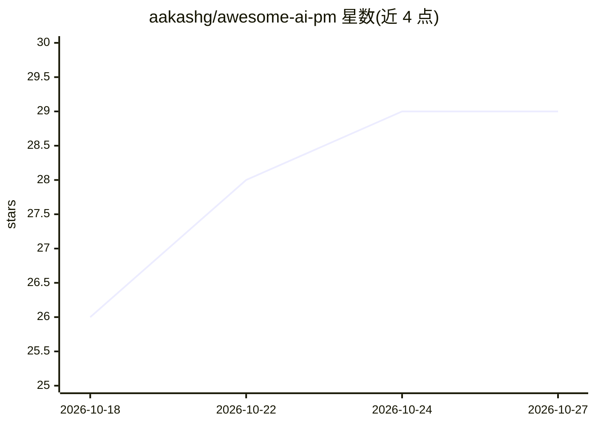

# aakashg/awesome-ai-pm

⭐ 29 · MIT · 推送 2026-03-03 · [GitHub](https://github.com/aakashg/awesome-ai-pm) · [官网](https://www.news.aakashg.com) · 个人维护

**AI 产品经理策展知识清单：框架、工具、技能与资源**

由个人维护的 AI 产品管理领域 awesome 类策展清单：围绕 AI PM 基础概念、LLM 核心技术、产品发现、设计模式、定价模型、评估指标、Agent 架构与 MCP、原型工具栈等主题组织知识条目，每个主题附带概念表格、决策框架与外部资源链接。面向构建 AI 产品的产品经理，供其查阅概念定义、方法框架与选型参考。纯文档型清单，无安装运行步骤。

## 筛选速览

| 维度 | 判定 | 备注 |
|---|---|---|
| AI 角色 | `ai-knowledge` | 知识聚合/清单类 |
| 许可风险 | `permissive` | MIT |
| 部署形态 | `None` |  |
| 模型依赖 | — | README 未给出锁定关系 |
| 硬件要求 | — | 无带数字的原话,不猜 |
| 安装摩擦 | `low` | 无编译、无系统依赖或容器化 |
| 成熟度 | — | 结构信号不足 |

## 能力要点

- 按 10 余个主题组织概念表格、决策框架与资源链接
- 覆盖 LLM 概念、AI 定价模型、评估指标、Agent 架构等 PM 决策知识
- 含 RAG/微调/提示工程的选型对照表与原型工具栈对比

## 适用场景

- 产品经理系统学习 AI 产品管理的概念与方法
- 查 RAG、微调、Agent 等方案在什么场景下选用
- 参考 AI 定价模型与评估指标的定义和风险对照

## 场景标签

`精选清单` · 领域:学习与行业

## 证据(README 行号)

> L7: A curated guide to AI product management. Frameworks, tools, skills, and resources for PMs building AI products.
> L9: Built and maintained by Aakash Gupta | Product Growth Newsletter

## 星数曲线

2026-10-18 26 → 2026-10-27 29（+3）

---
*卡片 v1 · prompt 1.4 · 生成 2026-10-26 · 置信度 high · 依据 README sha `d45f4e72e220` · [字段定义](../../DATASET.md)*
