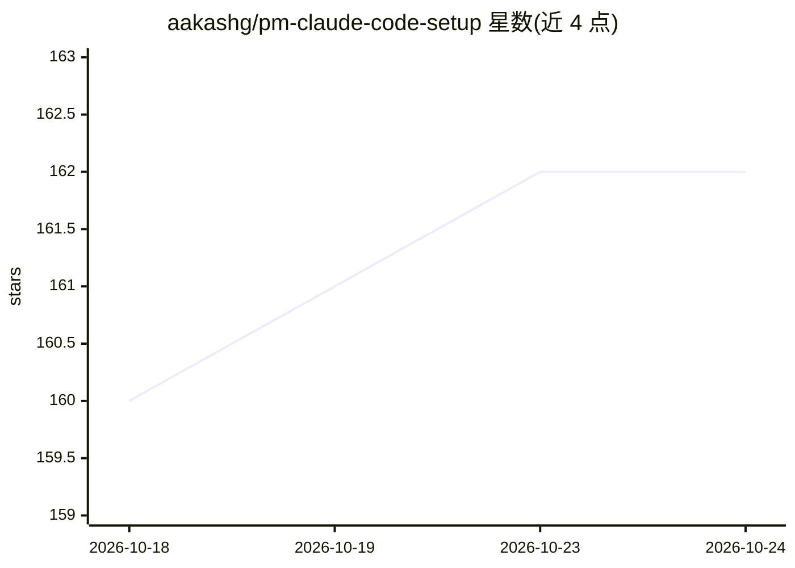

# aakashg/pm-claude-code-setup

⭐ 162 · MIT · 推送 2026-03-04 · [GitHub](https://github.com/aakashg/pm-claude-code-setup) · [官网](https://www.news.aakashg.com/p/pm-os) · 个人维护

**产品经理的 Claude Code 配置包：CLAUDE.md + 6 技能 + 4 模板**

面向产品经理的 Claude Code 配置文件集合：包含一份约 60 行的主上下文文件 CLAUDE.md（角色/写作规则/子代理评审表/输出标准）、6 个 PM 技能（含 PRD 写作技能，先生成澄清问题再产出结构化 PRD）和 4 个模板。安装方式为复制文件到项目根目录，Claude Code 启动时自动加载。README 同时介绍子代理链式评审、@ 引用、hooks、会话管理等使用方法，并推广作者的完整版付费 PM Operating System（41+ 技能）。

## 筛选速览

| 维度 | 判定 | 备注 |
|---|---|---|
| AI 角色 | `ai-ecosystem` | LLM/agent 周边工具 |
| 许可风险 | `permissive` | MIT |
| 部署形态 | `None` |  |
| 模型依赖 | — | README 未给出锁定关系 |
| 硬件要求 | — | 无带数字的原话,不猜 |
| 安装摩擦 | `low` | 无编译、无系统依赖或容器化 |
| 成熟度 | — | 结构信号不足 |

## 能力要点

- CLAUDE.md 主上下文文件定义角色、写作规则与 6 个子代理评审视角
- PRD 写作技能：先提 3-5 个澄清问题，再按假设/问题/方案/指标结构生成
- 含 6 个 PM 技能与 4 个模板，复制文件即完成设置
- README 提供 hooks、会话管理、MCP 连接等配置的排障说明

## 适用场景

- 让 Claude Code 按我的 PM 角色和写作规范产出文档
- 通过对话命令快速生成结构化 PRD
- 用多个子代理视角（工程师/设计师/怀疑者等）评审产出

## 场景标签

`提示工程` `AI 写作` · 领域:Agent 开发

## 证据(README 行号)

> L6: A production-ready Claude Code configuration for product managers. Drop these files into your project and Claude Cod
> L8: Includes a `CLAUDE.md` context file, 6 PM skills, and 4 templates. Takes 60 seconds to set up.

## 星数曲线

2026-10-18 160 → 2026-10-24 162（+2）

---
*卡片 v1 · prompt 1.4 · 生成 2026-10-22 · 置信度 high · 依据 README sha `7a4755d60c94` · [字段定义](../../DATASET.md)*
