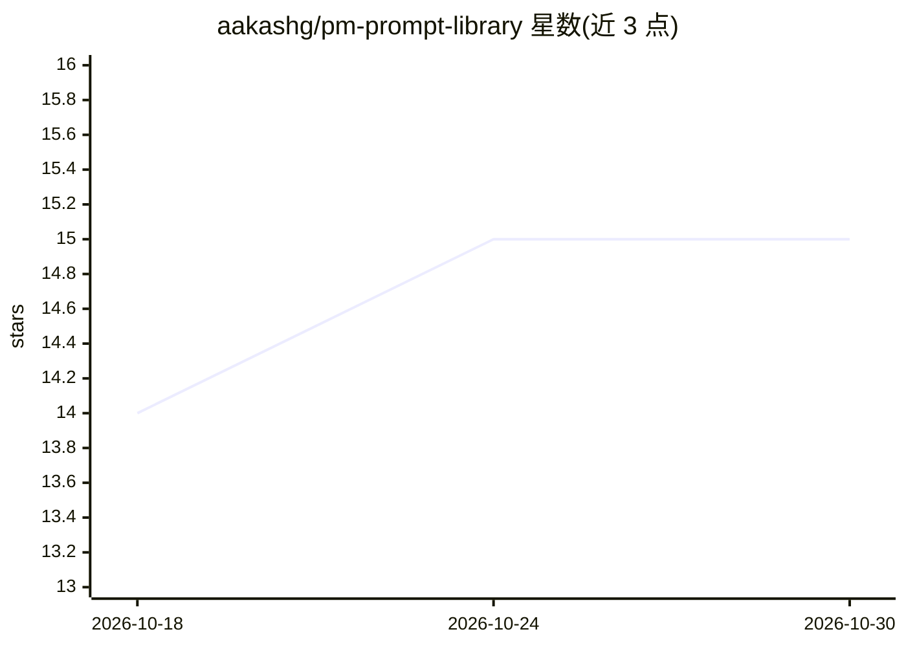

# aakashg/pm-prompt-library

⭐ 15 · MIT · 推送 2026-04-10 · [GitHub](https://github.com/aakashg/pm-prompt-library) · [官网](https://www.news.aakashg.com/p/pm-prompt-library) · 个人维护

**产品经理 AI 提示词集合：25 条免费样本，全库 82 条**

面向产品经理的提示词集合，免费开源 25 条，覆盖需求、战略、执行、分析、沟通、研究六大类场景（如用户故事生成、PRD 审查、路线图优先级、A/B 测试设计、复盘撰写）。每条提示词含完整文本、使用时机、示例输入输出与使用技巧。提示词可在 ChatGPT、Claude 及任意 LLM 中直接粘贴使用，需自行替换 [BRACKETED] 占位符；另宣传含 82 条提示词的完整付费库（12 类，含 B2B/B2C/市场/AI 产品变体）。

## 筛选速览

| 维度 | 判定 | 备注 |
|---|---|---|
| AI 角色 | `ai-knowledge` | 知识聚合/清单类 |
| 许可风险 | `permissive` | MIT |
| 部署形态 | `None` |  |
| 模型依赖 | — | README 未给出锁定关系 |
| 硬件要求 | — | 无带数字的原话,不猜 |
| 安装摩擦 | `low` | 无编译、无系统依赖或容器化 |
| 成熟度 | — | 结构信号不足 |

## 能力要点

- 25 条提示词覆盖 PM 工作流六大类（需求/战略/执行/分析/沟通/研究）
- 每条含完整提示词文本、使用时机、示例与技巧
- 兼容 ChatGPT、Claude 及任意 LLM
- 附 8 条通用提示词写作技巧

## 适用场景

- 把模糊需求转成带验收标准的用户故事
- 在分享前审查 PRD 或 API 规格文档
- 为功能设计 A/B 测试与成功指标
- 快速撰写干系人状态更新与发布说明

## 场景标签

`提示工程` · 领域:Agent 开发

## 证据(README 行号)

> L7: 25 battle-tested AI prompts for product managers. Copy, paste, customize, ship.
> L9: Works in ChatGPT, Claude, and any LLM. Each prompt tested across 50+ real PM scenarios.

## 星数曲线

2026-10-18 14 → 2026-10-30 15（+1）

---
*卡片 v1 · prompt 1.4 · 生成 2026-10-30 · 置信度 high · 依据 README sha `b01f81541868` · [字段定义](../../DATASET.md)*
