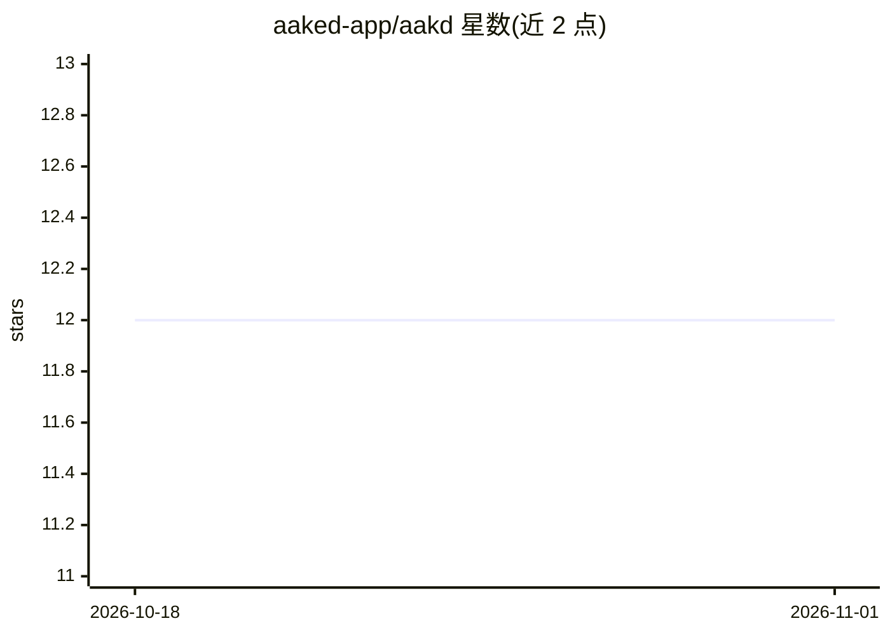

# aaked-app/aakd

⭐ 12 · TypeScript · AGPL-3.0 · 推送 2026-09-10 · [GitHub](https://github.com/aaked-app/aakd) · [官网](https://aakd.app) · 组织维护

**自托管的合同全生命周期管理平台，将已签署合同转为可追踪的义务与行动**

面向合同运营团队的开源自托管 CLM 平台：上传已签署的 PDF/DOCX 后，提取带页面级引用来源的字段与义务，支持人工校正、指派负责人与截止日期、续约/审批跟踪与完成证据留存。AI 为可选功能，启用后辅助提取、问答、风险信号与义务建议，输出保持可审查且不作为合同事实的唯一来源；可通过 provider key 或本地 Ollama 使用。OCR 在本地 worker 运行，目前仅支持英语。以 Docker Compose 本地栈与 Ubuntu 生产安装脚本两种方式部署。

## 筛选速览

| 维度 | 判定 | 备注 |
|---|---|---|
| AI 角色 | `ai-enhanced` | 去掉 AI 部分产品仍成立 |
| 许可风险 | `viral` | AGPL-3.0 |
| 部署形态 | `self-host` | docker 或自建部署 |
| 模型依赖 | local-ok | 支持本地模型 |
| 硬件要求 | — | 无带数字的原话,不猜 |
| 安装摩擦 | `low` | 无编译、无系统依赖或容器化 |
| 成熟度 | `idea` | |

## 能力要点

- 从已签署 PDF/DOCX 提取带页面级引用来源的事实与义务
- 义务/续约视图含负责人、截止日期、提醒与审计历史
- 可选 AI（Anthropic/OpenAI/Ollama），AI 输出可审查且保存来源引用
- 本地 worker 运行 OCR（捆绑英语模型），无需外部服务

## 适用场景

- 团队把已执行合同转成可指派、可追踪的义务与续约事项
- 在自有基础设施上托管合同仓库并控制数据隐私
- 用本地 Ollama 做 AI 辅助提取而不把合同送出内网

## 场景标签

`文档解析` `文档问答` · 领域:知识与检索

## 证据(README 行号)

> L40: AI is optional. When enabled, it assists with extraction, questions, risk
> L64: - Optional AI through a provider key or local Ollama deployment.

## 星数曲线

2026-10-18 12 → 2026-11-01 12（+0）

---
*卡片 v1 · prompt 1.4 · 生成 2026-11-01 · 置信度 high · 依据 README sha `0623f285d663` · [字段定义](../../DATASET.md)*
