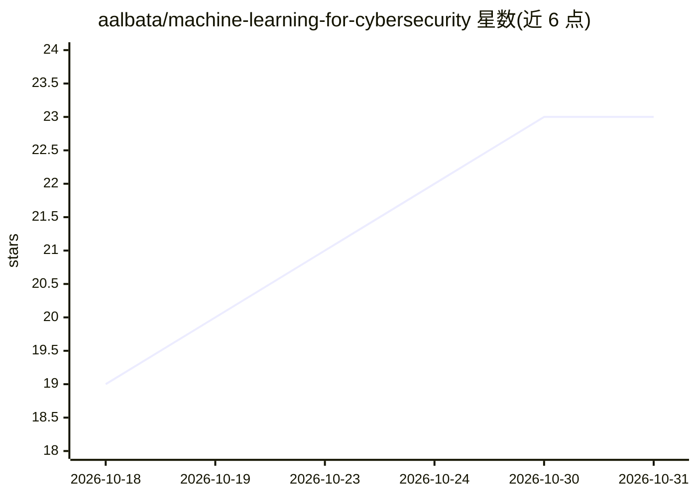

# aalbata/machine-learning-for-cybersecurity

⭐ 23 · Jupyter Notebook · MIT · 推送 2026-10-16 · [GitHub](https://github.com/aalbata/machine-learning-for-cybersecurity) · [官网](https://aalbata.github.io/machine-learning-for-cybersecurity/) · 组织维护

**免费机器学习与网络安全课程：11 单元含实验、习题与测验**

由阿联酋高等技术学院 Ali Al Bataineh 博士编写的免费在线课程，覆盖两个方向：机器学习应用于入侵/恶意软件/钓鱼/欺诈检测，以及机器学习系统自身的攻防（对抗样本、数据投毒、深度伪造、提示注入）。11 个单元各含 3 讲课程、可运行的实验（Google Colab 或本机 CPU，无需 GPU）、带解答的习题与自测题，第 12 单元为自选项目指南。代码 MIT、内容 CC BY 4.0，全部数字与图表可从源码重建。

## 筛选速览

| 维度 | 判定 | 备注 |
|---|---|---|
| AI 角色 | `ai-knowledge` | 知识聚合/清单类 |
| 许可风险 | `permissive` | MIT |
| 部署形态 | `library` | 以包/库形式分发 |
| 模型依赖 | — | README 未给出锁定关系 |
| 硬件要求 | — | 无带数字的原话,不猜 |
| 安装摩擦 | `low` | 无编译、无系统依赖或容器化 |
| 成熟度 | — | 结构信号不足 |

## 能力要点

- 11 个单元 × 3 讲课程 + 实验 + 习题 + 测验的结构
- 实验可在 Colab 或本机 CPU 运行，无需 GPU 或付费服务
- 覆盖对抗样本、数据投毒、深度伪造检测、提示注入等 AI 安全主题
- 四个命令即可从源码重建全部数据、实验结果、图表与网站

## 适用场景

- 系统学习 ML 在入侵/恶意软件/钓鱼检测中的应用
- 了解对抗机器学习与 LLM 提示注入攻防
- 安全团队或预算有限的学习者免费自学并动手做实验

## 场景标签

`网络安全` `教程课程` · 领域:学习与行业

## 证据(README 行号)

> L8: The course covers two related subjects. The first is how machine learning is applied to security problems such as in
> L12: Units 1 to 11 each have three lessons with the mathematics, worked examples and references, labs that run on Google

## 星数曲线

2026-10-18 19 → 2026-10-31 23（+4）

---
*卡片 v1 · prompt 1.4 · 生成 2026-10-27 · 置信度 mid · 依据 README sha `4732caf17341` · [字段定义](../../DATASET.md)*
