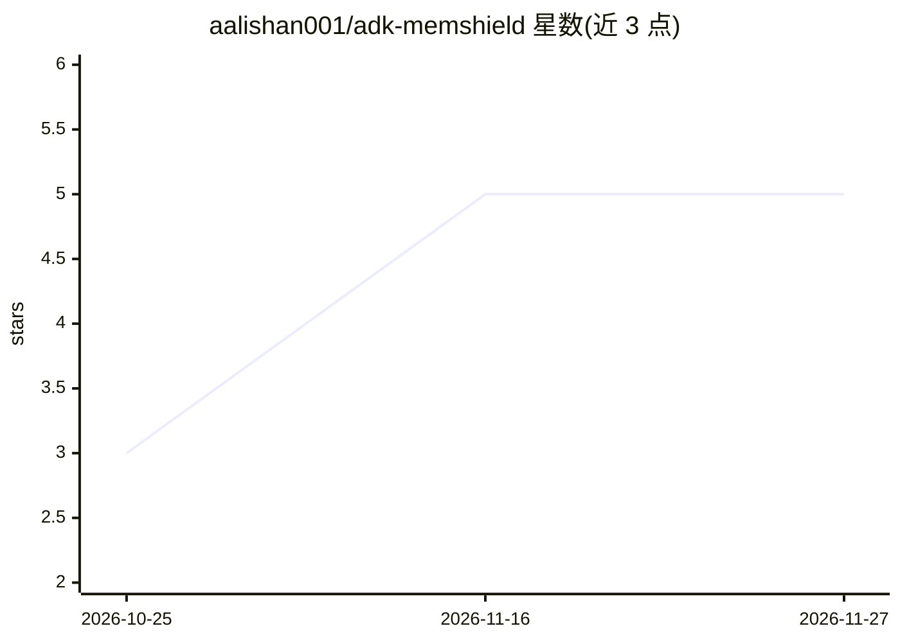

# aalishan001/adk-memshield

⭐ 5 · Python · Apache-2.0 · 推送 2026-11-22 · [GitHub](https://github.com/aalishan001/adk-memshield) · [官网](https://pypi.org/project/adk-memshield/) · 个人维护

**为 Google ADK/MCP agent 提供数据库强制的多租户安全语义记忆**

基于 PostgreSQL pgvector 与 Row-Level Security 的多租户 agent 记忆服务：将所有权门控从应用层下沉到数据库，用 FORCE ROW LEVEL SECURITY 与事务级身份绑定（set_config）实现隔离，缺少过滤条件时只会少返回行而非泄漏他人记忆。提供 Google ADK 的 drop-in 记忆服务、框架无关的核心库 MemShieldStore 及 MCP server，支持 clearance/compartment 分级访问、可选签名 token 身份验证，首次使用时运行时检查角色无 BYPASSRLS 等配置，并附泄漏基准评测与红队演示控制台。

## 筛选速览

| 维度 | 判定 | 备注 |
|---|---|---|
| AI 角色 | `ai-ecosystem` | LLM/agent 周边工具 |
| 许可风险 | `permissive` | Apache-2.0 |
| 部署形态 | `self-host` | docker 或自建部署 |
| 模型依赖 | — | README 未给出锁定关系 |
| 硬件要求 | — | 无带数字的原话,不猜 |
| 安装摩擦 | `low` | 无编译、无系统依赖或容器化 |
| 成熟度 | — | 结构信号不足 |

## 能力要点

- 所有权门控由 PostgreSQL FORCE RLS 在数据库层强制执行
- 框架无关核心库、Google ADK 记忆服务与 MCP server 三种形态
- 运行时拒绝不安全配置：超级用户、BYPASSRLS、缺策略即报错
- 提供泄漏基准（75 查询、5 场景）与在线红队演示控制台

## 适用场景

- 为多租户 agent 应用存储长期语义记忆并防跨用户泄漏
- 多 agent 协作场景中按 clearance 限制子 agent 可检索的记忆
- 对 agent 记忆系统做泄漏评测与安全态势监控

## 场景标签

`Agent 记忆` `模型评测` `网络安全` · 领域:Agent 开发

## 证据(README 行号)

> L3: **Zero-trust multi-tenant semantic memory for AI agents, enforced in the database by PostgreSQL `pgvector` + Row-Lev
> L25: - **Framework-neutral core** (`MemShieldStore`), an **MCP server** (`memshield-mcp`), and a `pre_write` hook that c

## 星数曲线

2026-10-25 3 → 2026-11-27 5（+2）

---
*卡片 v1 · prompt 1.4 · 生成 2026-11-21 · 置信度 mid · 依据 README sha `a6eac79d4fd3` · [字段定义](../../DATASET.md)*
