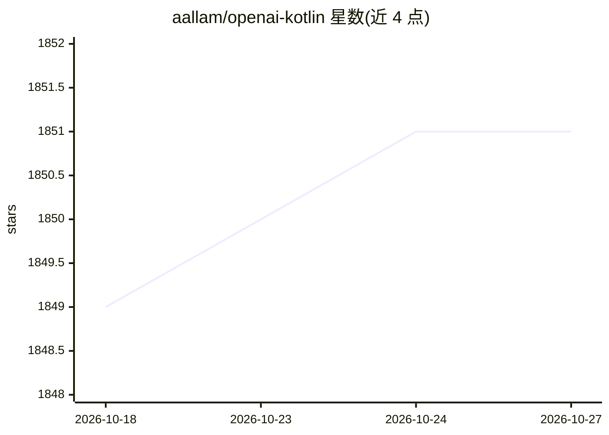

# aallam/openai-kotlin

⭐ 1,851 · Kotlin · MIT · 推送 2026-02-07 · [GitHub](https://github.com/aallam/openai-kotlin) · 个人维护

**面向 Kotlin 开发者的 OpenAI API 多平台客户端库**

为 Kotlin/JVM/JS/Wasm 等多平台项目提供 OpenAI API 的客户端库，基于 Kotlin 协程与 Ktor 引擎构建。覆盖 Responses、Chat、Images、Embeddings、Files、Fine-tuning、Audio、Batch 等正式特性，以及 Assistants、Vector Stores 等 Beta 特性；Completions 等已弃用。通过 Maven Central 分发，支持 Gradle BOM 与 Maven（JVM 限定）两种接入方式，内置 ProGuard/R8 规则，附带示例应用与活体集成测试开关。属非官方库，与 OpenAI 无隶属关系。

## 筛选速览

| 维度 | 判定 | 备注 |
|---|---|---|
| AI 角色 | `ai-ecosystem` | LLM/agent 周边工具 |
| 许可风险 | `permissive` | MIT |
| 部署形态 | `None` |  |
| 模型依赖 | — | README 未给出锁定关系 |
| 硬件要求 | — | 无带数字的原话,不猜 |
| 安装摩擦 | `low` | 无编译、无系统依赖或容器化 |
| 成熟度 | — | 结构信号不足 |

## 能力要点

- Kotlin 多平台支持（JVM/JS/Wasm，Maven 仅限 JVM）
- 基于 Kotlin 协程与可选 Ktor 引擎
- 覆盖 Responses/Chat/Images/Embeddings/Batch 等正式特性及 Assistants 等 Beta 特性
- 通过 Maven Central 分发，支持 Gradle BOM

## 适用场景

- 在 Kotlin 多平台项目中接入 OpenAI API
- 在 Android（R8）项目中调用 OpenAI 的 Chat 与 Embeddings 能力
- JVM Maven 项目中集成 OpenAI 接口

## 场景标签

 · 领域:LLM SDK/开发库

## 证据(README 行号)

> L7: Kotlin client for OpenAI's API with multiplatform and coroutines
> L85: - Responses

## 星数曲线

2026-10-18 1,849 → 2026-10-27 1,851（+2）

---
*卡片 v1 · prompt 1.4 · 生成 2026-10-21 · 置信度 high · 依据 README sha `a5c01ce6b0da` · [字段定义](../../DATASET.md)*
