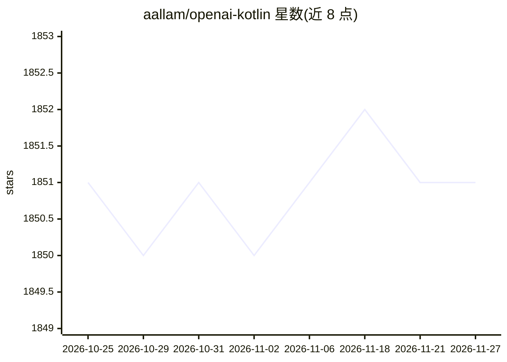

# aallam/openai-kotlin

⭐ 1,851 · Kotlin · MIT · 推送 2026-10-31 · [GitHub](https://github.com/aallam/openai-kotlin) · 个人维护

**Kotlin 开发者接入 OpenAI API 的多平台协程客户端**

Kotlin 编写的 OpenAI API 客户端库，支持 Kotlin 多平台（含 JVM/JS/wasmJs 等目标）与协程。通过 Maven Central/Gradle BOM/Maven 分发，需搭配 Ktor 引擎依赖。支持 Chat、Images、Embeddings、Audio、Files、Fine-tuning、Batch、Vector Stores、Realtime 等 API 能力，保留已退役的 Assistants 相关接口供存量用户使用，Completions 标记为 legacy。附带示例应用、ProGuard/R8 规则与 opt-in 的付费集成测试；README 声明为非官方库。

## 筛选速览

| 维度 | 判定 | 备注 |
|---|---|---|
| AI 角色 | `ai-ecosystem` | LLM/agent 周边工具 |
| 许可风险 | `permissive` | MIT |
| 部署形态 | `None` |  |
| 模型依赖 | — | README 未给出锁定关系 |
| 硬件要求 | — | 无带数字的原话,不猜 |
| 安装摩擦 | `low` | 无编译、无系统依赖或容器化 |
| 成熟度 | — | 结构信号不足 |

## 能力要点

- Kotlin 多平台客户端，支持协程
- 覆盖 Chat、Embeddings、Audio、Realtime、Vector Stores 等 OpenAI API 能力
- 支持 Gradle、Maven、BOM 多种依赖接入方式
- 内置 ProGuard/R8 规则，无需额外配置混淆

## 适用场景

- 在 Kotlin/JVM 项目中调用 OpenAI 的聊天与嵌入接口
- 构建 Kotlin Multiplatform 应用时统一访问 OpenAI API
- 对现有 Assistants 接口代码做迁移与维护

## 场景标签

 · 领域:开发工具/LLM SDK

## 证据(README 行号)

> L7: Kotlin client for OpenAI's API with multiplatform and coroutines
> L83: ### Supported features
> L197: **This is an unofficial library, it is not affiliated with nor endorsed by OpenAI**. Contributions are welcome.

## 星数曲线

2026-10-25 1,851 → 2026-11-27 1,851（+0）

---
*卡片 v1 · prompt 1.4 · 生成 2026-11-23 · 置信度 high · 依据 README sha `ecbf36b2fba5` · [字段定义](../../DATASET.md)*
