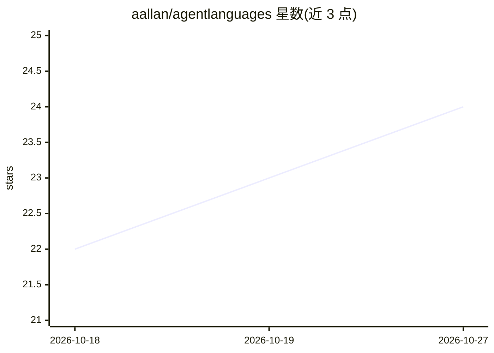

# aallan/agentlanguages

⭐ 24 · TypeScript · NOASSERTION · 推送 2026-10-26 · [GitHub](https://github.com/aallan/agentlanguages) · [官网](https://agentlanguages.dev/) · 个人维护

**面向 AI agent 的编程语言策展目录（三大流派分类）**

社区维护的 agent 编程语言目录站点（agentlanguages.dev）：收录以 LLM 与自主 agent 为代码主要作者的语言设计项目，按 Syntactic（降低 token 级歧义）、Verification（契约可机械校验）、Orchestration（agent 协调而非语言设计）三大流派分类，另设 Adjacent/Plumbing 与 Unclassified 类别。分类法源自 Negroni Venture Studios 的文章。站点基于 Astro 构建，附带每周 GitHub Action 刷新星标数的 Python 脚本。代码 MIT、内容 CC BY 4.0 双许可。

## 筛选速览

| 维度 | 判定 | 备注 |
|---|---|---|
| AI 角色 | `ai-knowledge` | 知识聚合/清单类 |
| 许可风险 | `none` | NOASSERTION |
| 部署形态 | `library` | 以包/库形式分发 |
| 模型依赖 | — | README 未给出锁定关系 |
| 硬件要求 | — | 无带数字的原话,不猜 |
| 安装摩擦 | `low` | 无编译、无系统依赖或容器化 |
| 成熟度 | — | 结构信号不足 |

## 能力要点

- 按 Syntactic/Verification/Orchestration 三大流派组织语言条目
- 社区可编辑的目录站点，线上运行于 agentlanguages.dev
- 每周自动刷新 GitHub 星标数据（构建时烘焙，非实时调用）
- 代码 MIT 与内容 CC BY 4.0 分离许可

## 适用场景

- 查找为 LLM/agent 设计代码而生的编程语言项目
- 了解 agent 语言设计领域的流派划分与演进
- 为 agent 语言项目寻找归属分类并提交收录

## 场景标签

`精选清单` · 领域:学习与行业

## 证据(README 行号)

> L5: A community-edited catalogue of programming languages designed for AI agents to author code, the site is live at age
> L7: The site catalogues an emerging field of language design that treats LLMs and autonomous agents — not humans — as th
> L9: - **Syntactic** — Strip ambiguity at the token level. Make syntax easier for LLMs to parse and generate.

## 星数曲线

2026-10-18 22 → 2026-10-27 24（+2）

---
*卡片 v1 · prompt 1.4 · 生成 2026-10-27 · 置信度 mid · 依据 README sha `d95018d6850d` · [字段定义](../../DATASET.md)*
