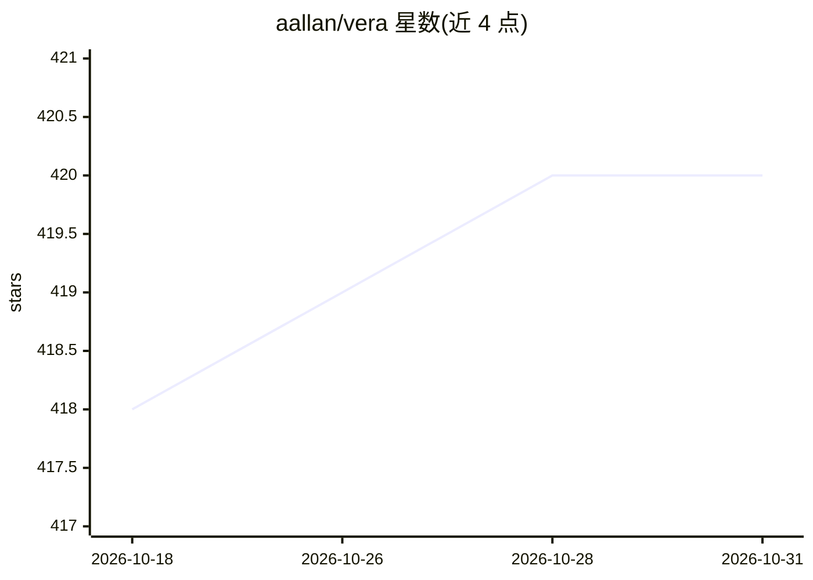

# aallan/vera

⭐ 420 · Python · MIT · 推送 2026-10-30 · [GitHub](https://github.com/aallan/vera) · [官网](https://veralang.dev/) · 个人维护

**面向 LLM 编程设计的验证型编程语言（编译到 WebAssembly）**

Vera 是一种以 LLM 为主要作者设计的编程语言：无变量名，改用 @Int.0 式结构引用；契约（requires/ensures）强制存在，由 vera verify 经 Z3 静态证明，无法判定的契约降级为运行时检查；效果（如 Inference、Http）在函数签名中显式声明；SQL 必须写死在源码、外部数据只能经占位符传入，从类型检查层面杜绝注入；错误信息面向模型输出，含诊断码与 JSON 格式。程序编译为 WebAssembly，可在命令行、浏览器或 WASI Preview 2 宿主运行。通过 PyPI 安装 veralang，需 Python 3.11+，也提供源码安装路线。

## 筛选速览

| 维度 | 判定 | 备注 |
|---|---|---|
| AI 角色 | `ai-ecosystem` | LLM/agent 周边工具 |
| 许可风险 | `permissive` | MIT |
| 部署形态 | `library` | 以包/库形式分发 |
| 模型依赖 | — | README 未给出锁定关系 |
| 硬件要求 | — | 无带数字的原话,不猜 |
| 安装摩擦 | `low` | 无编译、无系统依赖或容器化 |
| 成熟度 | — | 结构信号不足 |

## 能力要点

- 契约由 Z3 静态证明，不可判定契约降级为运行时检查（分层 Tier 1/3）
- 无变量名，使用结构引用；效果行显式声明（含 LLM 推断效果）
- SQL 注入形式在类型检查层面被拒绝编译（E207）
- 错误诊断为面向模型的修复指令，支持稳定错误码与 --json 结构化输出
- 编译到 WebAssembly，运行于 CLI/浏览器/WASI Preview 2

## 适用场景

- 让 LLM agent 编写可被编译器验证正确性的程序
- 构建需要形式化契约与效果控制的 AI 生成代码工作流
- 产出可移植到浏览器或 WASI 宿主的 WebAssembly 程序

## 场景标签

 · 领域:编程语言/形式化验证

## 证据(README 行号)

> L3: Vera — A language designed for machines to write
> L27: Vera addresses this by making everything explicit and verifiable. The model doesn't need to be right, it needs to b
> L156: The workflow: an LLM agent writes Vera with mandatory contracts; vera check and vera verify prove the types and co

## 星数曲线

2026-10-18 418 → 2026-10-31 420（+2）

---
*卡片 v1 · prompt 1.4 · 生成 2026-10-22 · 置信度 high · 依据 README sha `df505eafec93` · [字段定义](../../DATASET.md)*
