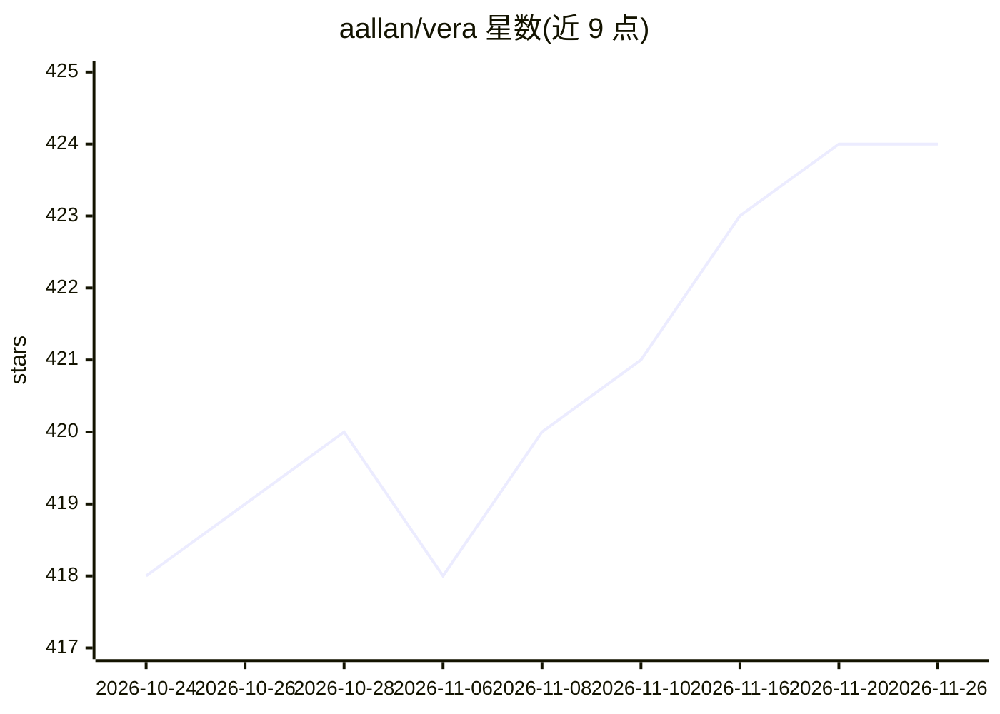

# aallan/vera

⭐ 424 · Python · MIT · 推送 2026-11-25 · [GitHub](https://github.com/aallan/vera) · [官网](https://veralang.dev/) · 个人维护

**面向 LLM 编写而设计的可验证编程语言与工具链**

Vera 是一种为大型语言模型编写代码而设计的编程语言：无变量名（结构化引用替代命名）、强制契约（requires/ensures）、类型化效应（LLM 推理/HTTP 需在签名声明）。程序经 Z3 静态证明契约，不可判定的转为运行时检查，编译产物为 WebAssembly，可在命令行、浏览器或 WASI 0.2 主机运行。以 PyPI 包 veralang 分发，含编译器、验证器、语言服务器（LSP）与结构化 JSON 诊断；错误信息以指令形式直接回传给 agent。要求 Python 3.11+，部分平台依赖 z3-solver wheel。

## 筛选速览

| 维度 | 判定 | 备注 |
|---|---|---|
| AI 角色 | `ai-ecosystem` | LLM/agent 周边工具 |
| 许可风险 | `permissive` | MIT |
| 部署形态 | `library` | 以包/库形式分发 |
| 模型依赖 | — | README 未给出锁定关系 |
| 硬件要求 | — | 无带数字的原话,不猜 |
| 安装摩擦 | `low` | 无编译、无系统依赖或容器化 |
| 成熟度 | — | 结构信号不足 |

## 能力要点

- 强制契约 + Z3 SMT 求解器静态证明，未证明项转为运行时检查
- 类型化效应：调用 LLM 或 HTTP 必须在签名中声明
- 错误诊断包含修复示例与规范引用，支持 --json 结构化输出
- 编译到 WebAssembly，支持命令行/浏览器/WASI 0.2 运行

## 适用场景

- 让 LLM agent 编写带有机器可验证契约的代码
- 对 AI 生成的代码做静态证明与运行时检查
- 构建调用 LLM 推理并显式追踪效应的程序

## 场景标签

`代码生成` · 领域:编码与开发

## 证据(README 行号)

> L10: **Vera** (v-ERR-a) is a programming language designed for large language models to write. The name comes from the L
> L27: Vera addresses this by making everything explicit and verifiable. The model doesn't need to be right; it needs to b
> L158: The workflow: an LLM agent writes Vera with mandatory contracts; vera check and vera verify check every type and p

## 星数曲线

2026-10-24 418 → 2026-11-26 424（+6）

---
*卡片 v1 · prompt 1.4 · 生成 2026-11-25 · 置信度 high · 依据 README sha `0875857a9cb0` · [字段定义](../../DATASET.md)*
