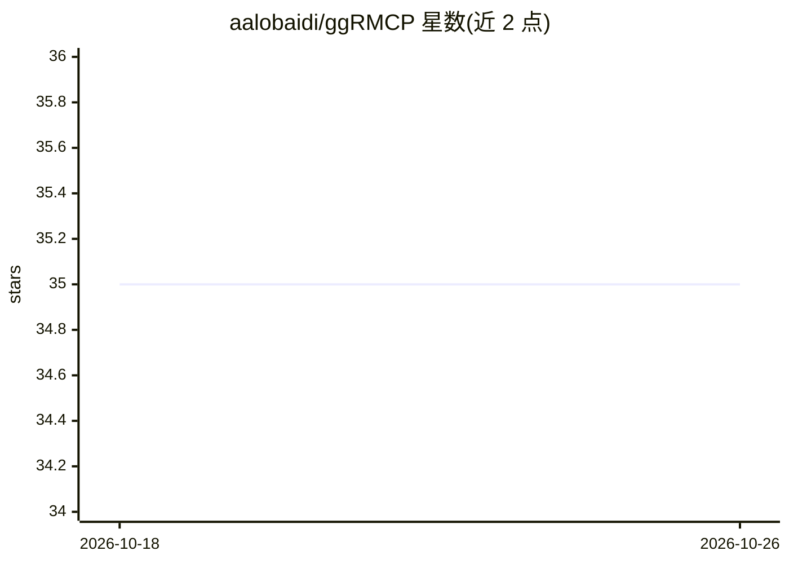

# aalobaidi/ggRMCP

⭐ 35 · Go · MIT · 推送 2025-12-29 · [GitHub](https://github.com/aalobaidi/ggRMCP) · 个人维护

**将 gRPC 服务转换为 MCP 工具的 Go 网关**

Go 语言编写的网关：通过 gRPC reflection 或 FileDescriptorSet 文件发现 gRPC 服务的方法，动态生成 MCP 工具（protobuf schema 转 JSON schema，JSON 与 protobuf 请求/响应自动互转），使 Claude 等 AI 客户端可直接调用既有 gRPC 服务，无需修改服务代码。支持 Sidecar 或集中式网关部署，提供会话管理、限流、HTTP 头过滤转发、健康检查与 /metrics 端点。README 声明为实验性项目，尚非生产可用。安装方式为 git clone 后 go build 从源码构建。

## 筛选速览

| 维度 | 判定 | 备注 |
|---|---|---|
| AI 角色 | `ai-ecosystem` | LLM/agent 周边工具 |
| 许可风险 | `permissive` | MIT |
| 部署形态 | `library` | 以包/库形式分发 |
| 模型依赖 | — | README 未给出锁定关系 |
| 硬件要求 | — | 无带数字的原话,不猜 |
| 安装摩擦 | `medium` | 含编译或系统依赖之一 |
| 成熟度 | `idea` | |

## 能力要点

- gRPC reflection / FileDescriptorSet 双通道服务发现并动态生成 MCP 工具
- protobuf schema 转 JSON schema，请求/响应自动互转与校验
- Sidecar 或集中式网关两种部署模式，语言无关、零代码修改
- 会话管理、限流、HTTP 头安全过滤与 /health、/metrics 端点

## 适用场景

- 让 Claude Desktop 等 MCP 客户端直接调用我现有的 gRPC 服务
- 以 Sidecar 容器形式随服务部署，暴露 gRPC 能力给 AI 应用
- 集中式网关统一代理多个 gRPC 后端供 AI 调用

## 场景标签

`模型网关` · 领域:Agent 开发

## 证据(README 行号)

> L10: ggRMCP is a high-performance Go-based gateway that converts gRPC services into MCP-compatible tools, allowing AI mo
> L32: - **Tool Registration**: Each gRPC method becomes an MCP tool

## 星数曲线

2026-10-18 35 → 2026-10-26 35（+0）

---
*卡片 v1 · prompt 1.4 · 生成 2026-10-25 · 置信度 mid · 依据 README sha `a4576c0be3a8` · [字段定义](../../DATASET.md)*
