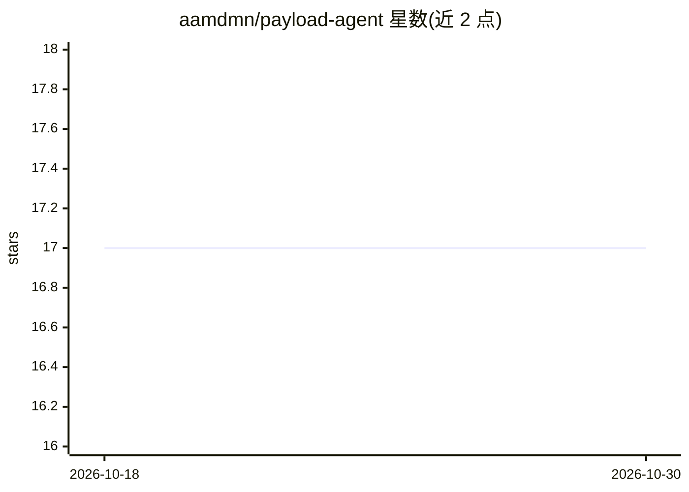

# aamdmn/payload-agent

⭐ 17 · TypeScript · MIT · 推送 2026-09-17 · [GitHub](https://github.com/aamdmn/payload-agent) · [官网](https://agent.aamdmn.com) · 个人维护

**Payload CMS 插件：通过 Telegram/Slack 等聊天平台用 AI agent 管理内容**

面向 Payload CMS 3.37+ 的插件（Node.js ^18.20.2 或 >=20.9.0），在 CMS 实例中嵌入对话式 AI agent，用户从 Telegram、Slack、Discord、WhatsApp、Teams 等聊天平台查询与管理内容。模型编排基于 TanStack AI（支持 Anthropic/OpenAI 等可插拔 provider），工具执行采用 Code Mode：在 esbuild + isolated-vm 沙箱中运行 TypeScript 直连 Payload Local API。默认关闭 delete、限制每消息 50 次写操作，生产环境需配置持久化状态适配器（Postgres/Redis）。README 标注为开发中。

## 筛选速览

| 维度 | 判定 | 备注 |
|---|---|---|
| AI 角色 | `ai-ecosystem` | LLM/agent 周边工具 |
| 许可风险 | `permissive` | MIT |
| 部署形态 | `library` | 以包/库形式分发 |
| 模型依赖 | locked-api |  |
| 硬件要求 | — | 无带数字的原话,不猜 |
| 安装摩擦 | `low` | 无编译、无系统依赖或容器化 |
| 成熟度 | `idea` | |

## 能力要点

- 8 种内容操作工具（getSchema/find/create/update/delete/count/uploadFile 等），支持多步组合
- Code Mode 沙箱直接运行 TypeScript 调用 Payload Local API
- 本地化感知：可跨 locale 读取并由 LLM 翻译后逐 locale 写入
- 默认安全作用域：跳过内部与认证集合、每消息写操作上限 50、提示注入防护

## 适用场景

- 在 Telegram/Slack 里直接查询和增改 Payload CMS 内容
- 让 AI agent 将内容翻译成多个 locale 并分别写入
- 通过聊天发送文件由 agent 上传到媒体集合

## 场景标签

`AI 助手` · 领域:对话与助手

## 证据(README 行号)

> L4: Adds a conversational AI agent directly inside your Payload instance. Users query and manage content through chat pl
> L6: Powered by Chat SDK for multi-platform messaging, TanStack AI for model orchestration, and Code Mode for reliable to
> L17: `payload-agent` ships the agent core. You bring **one AI provider** and **one or more chat adapters** and pass inst

## 星数曲线

2026-10-18 17 → 2026-10-30 17（+0）

---
*卡片 v1 · prompt 1.4 · 生成 2026-10-29 · 置信度 high · 依据 README sha `4bb70dc5bb67` · [字段定义](../../DATASET.md)*
